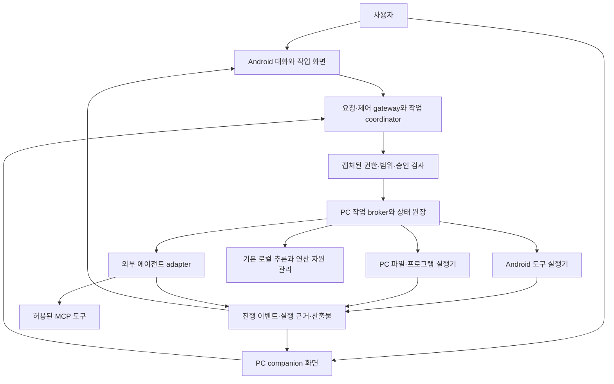
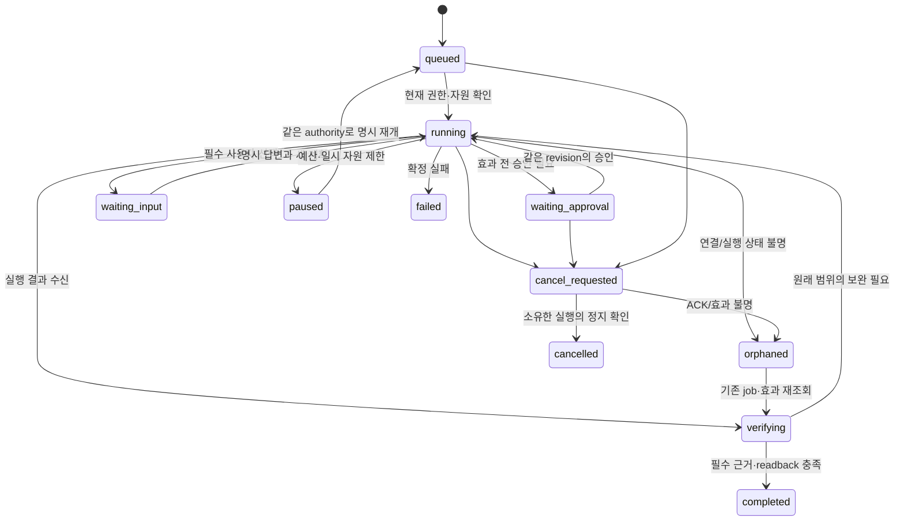

# ZipHap.Agent: 스마트폰 비서와 PC·스마트폰 통합 제어 설계

작성 시작: 2026-11-14, 마지막 검토: 2026-11-15 KST. 상태: **상세 설계 / 통합 검토 대상**. 이 문서는 실행 중인 PC 에이전트 연결이나 양쪽 기기 제어를 설치·검증했다는 보고가 아니다. 현재 Android 기능을 보존하면서 단계별로 확장하기 위한 계약과 빌드 구조다.

## 1. 제품의 기준

ZipHap.Agent는 기본적으로 스마트폰 비서다. 같은 대화 안에서 연락처·메모·일정·알림·허용된 메시지와 파일을 다루고, 필요한 경우 PC의 파일·프로그램·실행 중인 에이전트까지 연결한다. 사용자는 자료를 창마다 복사하거나 작업 종류 탭을 먼저 선택할 필요가 없다. 스마트폰과 PC의 작업을 함께 지시하고, 두 기기의 신뢰된 사용자 화면에서 진행·승인·중지·재개를 다룬다.

다음 두 축은 독립적이다.

| 축 | 의미 |
|---|---|
| 입력·제어 위치 | 스마트폰 대화, 향후 PC companion 화면. 어느 화면을 열었는지가 작업 권한을 늘리지 않는다. |
| 실행 위치 | Android 도구, PC 내장 실행기, PC의 외부 에이전트와 허용된 MCP. 실행 위치마다 자체 권한과 결과 검사를 적용한다. |

기본 추론은 현재 승인된 paired-PC의 로컬 경로를 유지한다. 스마트폰 비서라는 제품 역할을 휴대폰 단독 추론이 이미 동작한다는 뜻으로 사용하지 않는다. PC가 없을 때 폰·외부 유료 경로로 자동 우회하지 않는다. 외부 에이전트는 작업에 명시적으로 허용된 별도 실행 경로다. 새 유료 API 키를 일상 사용의 전제로 만들지 않는다.

앱 이름·applicationId·서명은 유지한다. 현재 대화·목표·승인·자료·모델 선택·업데이트를 삭제하거나 새 앱으로 옮기는 재작성은 하지 않는다.

## 2. 참고 영상에서 확인한 범위

[참고 영상](https://www.youtube.com/watch?v=BQ8ptkZ4kdg)은 단테랩스의 Herdr 데스크톱 사례다. 브라우저에서 설명과 한국어 자막을 확인했다. 아래는 관찰한 사용 흐름이며 ZipHap에서 검증한 기능이 아니다.

- 4:09~6:04: 조율 담당이 구현·검토 담당에게 요청을 보내고 보고를 되돌려 받는다. 역할·보고 대상과 실제 연결 도구가 필요하다.
- 6:12~7:47: 진행·입력 대기를 표시하지만, 상태를 보고하지 않는 에이전트는 미확인으로 남긴다.
- 7:50~12:14: PC의 같은 작업을 휴대폰에서 이어 보고 지시·승인한다. 모바일에서 승인 선택지가 제대로 보이지 않는 장면도 있다.
- 12:16 이후: 같은 프로젝트 폴더를 사용하는 것과 실행 중인 세션을 공유하는 것은 다르다.

채택할 원칙은 **위임과 보고의 연결, 실제 세션 식별, 양쪽 화면의 같은 작업 제어, 구조화된 승인**이다. UI 배치나 터미널 출력만으로 실행 상태·세션 공유·완료를 추정하지 않는다. Herdr의 구조는 [공식 가이드](https://herdr.dev/guide/)와 [공식 저장소](https://github.com/herdrdev/herdr-app)도 참고했다. 코드를 가져오거나 설치한 상태는 아니다.

## 3. 현재 구현과 새 구성요소의 연결

읽기 시작 기준은 `8c3ed07` 위의 통합 변경이며 최종 점검 HEAD는 `f25a2e2b0382c72012e9a853dea841f50c519c93`이다. `PROJECT_STATE.md`는 현재 설치1060, 등록102도구, JVM1321, 실제 폰 통제 검사42건을 기록한다. 통제 검사는 실제 모델 업무 성공과 다르며 신규 실제 모델6개 워크플로우는 해당 기록 시점에 미실행이다. 작성 중인1061 진단 후보를1060 설치 증거로 합치지 않는다. 배포 판정에는 그 문서와 루트의 최신 영수증을 사용한다.

도구별 실제 범위는 [도구·실행 경계 설계](tool-execution-boundaries.ko.md), 빌드·승격 기준은 [빌드·릴리스·검증 설계](build-release-validation.ko.md)와 함께 읽는다. 본 문서는 두 문서의 실행 불변조건을 대체하지 않는다.

| 책임 | 현재 실제 구성요소 | 확장 방향과 남은 차이 |
|---|---|---|
| 한 대화의 요청·큐·추가 지시 | `ChatRunCoordinator`, `ChatCommands`, `ChatRunState.QueuedChatRequest` | 기존 parent run을 보존하고 PC child job 참조·이벤트 projection을 추가한다. 거대한 실행 함수를 더 키우지 않는다. |
| 목표 | `ChatGoalLifecycle`, `ChatGoalStore`, `ScopedGoalTools`, `GoalRunEvidence` | 명시적 지속 목표에만 child job과 기준별 근거를 연결한다. 에이전트 종료를 목표 완료로 바꾸지 않는다. |
| 의도·다음 행동 | `LocalSemanticPlanner`, `SemanticRequestPlanning`, `PostReadActions`, `TaskHarness` | 실제 capability snapshot에서 다음 행동·위임을 선택한다. 기존 semantic/direct 비교의 동등 계약을 먼저 갖춘다. |
| Android 실행·승인 | `ToolRegistry`, `ToolExecutor`, `RecipientEvidence`, 실제 대상 preview | PC 요청도 동일 실행 경계를 거친다. 외부 에이전트가 Android 권한을 직접 얻지 않는다. |
| 자료·프로젝트 | `LocalRepository`, `ChatRecords`, `ProjectWorkspace`, `ProjectReadDelivery` | 폰 자료 범위와 PC workspace를 별도 binding으로 관리한다. 파일 SHA·전체 원문 읽기 근거를 보존한다. |
| PC 연결·추론 | `PcTransport`, `PcInferenceEngine`, `AutomaticComputeEngine`, `PcTextAuthority` | 기존 추론 RPC를 agent-session RPC로 착각하지 않는다. 기능 협상 후 별도 broker client를 연결한다. |
| PC 연산·수명 | `pc-worker/deployed/server.py`, `owned_engines.py`, `recovery_engines.py`, `supervisor.py` | gateway 뒤 별도 orchestration service와 resource broker를 추가한다. 현 worker를 실행 중 교체하지 않는다. |
| 진행·실행 근거 | `ChatWorkTraceSession`, `WorkTraceStore`, `AnalysisCompletionEvidence`, `ActionCompletionReport` | agent 보고와 host receipt를 분리하고 두 기기 UI가 같은 event sequence를 읽는다. |
| 개발 위임 MCP | `pc-worker/mcp/local_llm_mcp.py` | 외부 에이전트→로컬 모델 위임 구현이다. ZipHap→외부 에이전트 제어와는 방향이 다르다. 독립28검사 통과는 실제 클라이언트 연결 증거가 아니다. |
| 선택적 개인 브리핑 | `scripts/briefing_companion.py`, Android `briefing/` | 현재 외부 도구·MCP 호출을 차단한다. 별도 동의의 분석 경로를 범용 제어 우회로로 바꾸지 않는다. |

## 4. 전체 구성



화면, 작업 상태, 추론, 실제 실행을 분리한다. 화면을 닫는 것·터미널을 끝내는 것·PC를 재시작하는 것은 서로 다른 사건이다. 창이 열려 있다는 이유로 agent 연결을 ready로 표시하지 않는다.

### 작업의 원본과 제어권

- 기존 스마트폰 요청의 원본은 폰의 암호화된 run·목표·자료 범위다. PC broker는 위임받은 child job과 필요한 최소 자료를 보관한다.
- 첫 통합에서는 PC 화면에서 새로 넣은 요청도 폰의 parent run·권한 snapshot에 연결한다. PC 원장은 child 실행 상태와 필요한 최소 자료의 원장이다. PC에서 시작했다는 이유로 폰 자료·기억·동의의 원본을 바꾸거나 캐시에서 새로 허가하지 않는다.
- 각 job에는 생성 시 결정한 coordinator host와 control epoch가 하나만 있다. 두 화면은 제어 client다. 화면 전환이나 재연결로 leader가 두 개 생기지 않는다.
- PC 화면이 폰 parent run을 조작할 때는 같은 parent의 현재 revision을 확인한다. 연결이 끊겨도 PC child의 안전한 중지 요청은 가능하지만, 새 실행·재개·권한 확대는 해당 authority host 확인 없이 하지 않는다.
- 폰의 개인 자료와 PC 파일을 서로의 완전한 복제본으로 만들지 않는다. 데이터 이동·외부 provider 전송은 원래 요청에 캡처된 허용 범위를 따른다.

폰과 무관한 PC 전용 parent를 독립 생성하는 기능은 후속 옵션이다. 이를 추가하려면 별도의 PC-local authority·자료 소유 계약이 필요하며 현재 스마트폰 비서의 권한을 상속하지 않는다. 이 문서의 첫 통합 범위로 자동 활성화하지 않는다.

### 양방향 제어를 전달하는 통신

스마트폰이 기존 인증서 pin·페어링 identity를 사용하는 PC gateway로 **연결을 시작**한다. 첫 구현은 버전이 있는 HTTP 요청·제한된 long-poll/event stream과 cursor ACK를 사용한다. 폰으로 들어오는 새 공개 포트나 ADB 명령 전달을 전제로 삼지 않는다. WebSocket 등 추가 transport는 호환성·취소·재연결 검사를 마친 뒤 교체 가능한 adapter로 둔다.

PC에서 요청한 폰 작업은 broker에 대기 명령으로 기록되고 폰이 허용된 연결에서 받아 실행한다. 폰의 현재 app/OS 실행 가능 상태·permission·source binding을 확인하기 전에는 실행한 것으로 표시하지 않는다. 폰이 offline·Doze·프로세스 종료 상태이면 `waiting_device` 사유로 보류한다. WorkManager는 즉시 배달을 보장하지 않으며, 지속 연결이 필요한 foreground 경로는 실제 Android 요구와 동의·배터리 정책을 검증해야 한다.

PC companion은 인증된 로컬 IPC 또는 제한된 loopback client로 같은 원장을 읽는다. 로컬이라는 이유로 무인증 제어 endpoint를 열지 않는다. 웹 기반 PC 화면이면 origin·CSRF·client identity를 확인한다. 네트워크가 Tailscale로 바뀌어도 새 도구·자료 권한을 얻지 않는다.

이벤트는 `jobId/controlEpoch/sequence/observedAt/source`에 묶고 UI/원장에 저장한 cursor만 ACK한다. 중복·역순 이벤트는 projection에서 중복 적용하지 않는다. 연결 heartbeat와 agent 작업 상태는 별도이며, heartbeat가 있다고 실행·진행률을 만들어내지 않는다.

## 5. 모듈과 의존성

아래 트리는 목표 구조다. 현재 있는 파일과 앞으로 만들 파일을 구분하며 한 번에 디렉터리를 옮기지 않는다.

```text
core/                         # 기존 순수 Kotlin, Android 의존 없음
  .../core/                   # 기존 ToolRegistry/TaskHarness/목표·근거 계약 유지
  .../core/orchestration/     # 예정: envelope/상태 reducer/오류·근거 타입
app/                          # 기존 Compose/Room/Android 권한·도구
  .../orchestration/          # 예정: parent-child 연결, transport, event projection
  .../tools/                 # 실제 폰 executor의 기존 경계 유지
pc-worker/
  deployed/                  # 현재 배포 스냅샷, 즉시 source-of-truth로 합치지 않음
  mcp/                       # 외부 개발 에이전트의 로컬 모델 위임 서버
  agent_orchestration.py     # 예정: 부작용 없는 typed 상태계약의 첫 단계
  orchestration/             # 예정: 모듈이 커질 때 단계적으로 분리
    contracts.py
    state.py
    journal.py
    scheduler.py
    approvals.py
    evidence.py
    adapters/
    executors/
  tests/                     # 예정: broker·adapter의 독립/통합 fixture
protocol/orchestration/v1/    # 예정: JSON Schema·유효/거부 golden fixtures
docs/architecture/           # 책임·호환성·빌드/검증 설계
scripts/                     # 예정: 공개 재현 가능한 build/package/verify entrypoint
```

의존 방향은 `UI → coordinator → 계약/정책 → adapter·executor`다. 계약 모듈은 Android·프로세스·네트워크·provider SDK를 import하지 않는다. 실제 executor가 계약을 호출하며, LLM이 executor를 직접 호출하지 않는다. 첫 변경은 현재 `core/app` Gradle 모듈을 유지한 채 작은 클래스를 추출한다. 새 Gradle 모듈·새 PC 패키지 체계는 빌드 재현성 검사 뒤 별도 이동한다.

## 6. 공통 요청과 권한 snapshot

| 필드 | 계약 |
|---|---|
| `protocolVersion`, `schemaDigest` | 서로 지원하는 계약만 사용. 알 수 없는 실행 필드는 거부한다. |
| `taskId`, `parentRunId`, `jobId` | 요청·위임·실제 실행을 구분한다. 문자열을 같게 만들어 다른 작업에 붙일 수 없다. |
| `controlEpoch`, `expectedRevision` | 같은 작업의 오래된 화면·재전달·재시작을 검출한다. |
| `requestDigest`, `planRevision` | 원래 사용자 요청과 최신 정정을 묶는다. 정정은 기존 실행 근거를 새 권한으로 만들지 않는다. |
| `ownerBinding`, `projectBinding`, `branchBinding` | 페어링된 사용자·현재 프로젝트·대화 분기. 실제 ID는 비공개 저장한다. |
| `phoneDataBinding`, `pcWorkspaceBinding` | 폰 자료와 PC 파일의 범위를 각각 고정한다. 이름이 같은 폴더는 같은 binding이 아니다. |
| `capabilitySnapshot`, `permissionRevision` | 제출 시 실제 허용된 도구·효과·자료 범위. 이후 설정 증가를 상속하지 않는다. |
| `providerPolicy`, `modelSelection`, `reasoningProfile` | 로컬 기본값, 허용 provider, 선택한 모델·추론 강도와 상한. 에이전트가 임의로 바꾸지 않는다. |
| `deadline`, `stepBudget`, `delegationBudget` | 시간·도구·하위 작업 상한. 명시한 지속 목표도 무한 반복 실행 권한이 아니다. |
| `idempotencyKey` | 같은 요청의 네트워크 재전달을 같은 job으로 연결한다. 같은 key·다른 payload는 충돌이다. |

기존 `QueuedChatRequest`의 `allowTools/mode/workspaceBinding/pcDataBinding/kakaoReadBinding/capturedPcRevision/allowCloudText`는 유지한다. 새 PC agent authority는 별도 versioned 필드로 추가하고 legacy 요청의 기본값은 **외부 agent/MCP 실행 불허**다. 현재 `allowCloudText`를 모든 외부 에이전트·MCP·자료 반출의 포괄 동의로 재사용하지 않는다.

로컬 프로세스에서 Codex·Claude를 실행해도 추론·MCP가 외부 서비스로 나가면 외부 경로다. 계정 로그인 방식과 자료 전송 허용은 별도다. API 키가 없다는 사실이 로컬 처리나 무비용을 입증하지 않는다. 모델·provider·외부 연결 선택 변경은 권한 revision을 갱신하고 오래된 작업의 새 효과를 차단한다.

### 타입과 신뢰된 생성 주체

`SubmissionIntent`는 사용자의 요청·자료 reference·원하는 역할을 담는다. 모델/외부 agent가 제안할 수 있다. 반면 `ExecutionBinding/ExecutionGrant/ApprovalBinding/ExecutionReceipt`는 도구 경계 문서의 host 타입이다. authority host가 ledger와 실제 상태로 생성하며, 받은 JSON 안의 필드를 그대로 grant로 채택하지 않는다. wire에 전달한 `grantHandle`도 ledger 조회·현재 scope/취소 검사를 생략할 권한이 아니다.

| 타입 | 초기 v1 제안 제약 |
|---|---|
| binding/operation ID | host가 발급하는1~100자 opaque 문자열, 제어문자 금지. 대상을 찾는 표시 이름과 구분 |
| revision/epoch/sequence | bool이 아닌0 이상의 정수. 제어 revision과 event sequence를 혼용하지 않음 |
| digest | 실제 바이트 또는 canonical 직렬화 방식이 명시된64자리 소문자 SHA-256. 모델이 제공한 값은 proof가 아님 |
| capability/target | 신뢰된 등록 namespace와 관찰한 ResourceRef. 원래 grant의 subset인지 검사 |
| provider/model/effort | 실제 provider capability snapshot에서 고른 값. 미지원 강도를 임의 상향·다운그레이드하지 않음 |
| 객체/이벤트 | 알려진 필드만 허용, 중복 키·비유한 수·잘린 JSON 거부. 최대 깊이·메시지/배치 한도는 schema/golden fixture에 고정 |
| 예산/기한 | 유한한 정수와 profile 버전. 현재 parent의 단계·자원 상한을 넘지 않음. 달력 시각과 elapsed deadline을 구분 |

초기 `TaskRequestV1`의 host 필수값은 task/parent·owner/project/branch·폰/PC 자료 binding·control epoch/revision·원래 요청 digest·권한 revision/ledger handle·provider/model/추론 profile·예산·idempotency key다. 없는 branch/자료 binding은 명시 null이며 해당 자료 capability가 없어야 한다. event는 job/epoch/sequence·원래 action/provider session binding·관찰 시각·발행 host를 필수로 한다. 최종 wire schema와 양 언어 parser를 단계1에서 같은 golden fixtures로 고정한다.

예시는 합성값이며 아직 wire schema로 출시된 형식이 아니다. 인증용 토큰이나 실제 기기 주소는 envelope에 넣지 않는다.

```json
{
  "protocolVersion": 1,
  "taskId": "example-task",
  "parentRunId": "example-phone-run",
  "controlEpoch": 1,
  "expectedRevision": 0,
  "planRevision": 0,
  "requestDigest": "aaaaaaaaaaaaaaaaaaaaaaaaaaaaaaaaaaaaaaaaaaaaaaaaaaaaaaaaaaaaaaaa",
  "ownerBinding": "example-paired-owner",
  "projectBinding": "example-project",
  "branchBinding": "example-branch",
  "phoneDataBinding": "example-selected-phone-note",
  "pcWorkspaceBinding": "example-selected-pc-workspace",
  "permissionRevision": 12,
  "grantHandle": "example-host-ledger-handle",
  "allowedCapabilities": ["phone.read_selected_note", "pc.create_private_document"],
  "providerPolicy": {"default": "local", "allowed": ["local"], "remoteTextAllowed": false},
  "modelSelection": {"modelRef": "configured-pc-text", "reasoningProfile": "configured"},
  "budgets": {"maxSteps": 12, "maxDelegations": 2, "deadlineSeconds": 600},
  "idempotencyKey": "example-request-once"
}
```

## 7. 계획·역할·위임

모델은 현재 요청·최신 정정·실제 capability snapshot을 읽고 필요한 다음 행동을 고른다. 단순한 폰 조회에 PC multi-agent 단계를 강제하지 않는다. 큰 작업이면 자료 조사·구현·검토 등의 역할, 의존 관계, 대상 workspace와 완료 조건을 제안한다. 역할명은 tool authority가 아니다.

동작은 `원래 요청 → 필요한 자료/지침 → 모델의 다음 행동 → 실행 전 검사 → 실제 관찰 → 다음 행동/검증 → 결과`로 이어진다. 전역 선분류를 영구 요건으로 두지 않는다. semantic/direct-next-action 비교는 도구 정의·스킬 접근·목표/종료·권한·질문·시간/토큰 예산을 맞춘 후 별도 측정한다. 키워드 라우터·문장별 고정 답변을 의도 해석기로 복원하지 않는다.

하위 에이전트에는 원래 요청에서 필요한 부분·관찰한 자료·허용된 행동·보고 형식만 보낸다. 하위가 만든 새 작업은 부모의 capability·자료·provider·예산의 부분집합이어야 한다. 하위에게 추가 agent 설치·권한 변경·삭제·발송 권한을 스스로 만들게 하지 않는다.

## 8. 에이전트와 MCP adapter

공통 adapter 표면은 `discover`, `read_capabilities`, `attach_or_start`, `submit`, `observe`, `steer`, `request_cancel`, `reconcile`, `close_owned_session`이다. 지원하지 않는 연산은 `UNSUPPORTED`다. 실제 세션을 찾지 못했으면 새 작업을 시작하고 기존 대화에 연결됐다고 표시하지 않는다.

| 경로 | 후보 계약 | 현재 gap |
|---|---|---|
| 기본 PC 로컬 모델 | 기존 pinned compute RPC와 request owner | 실제 agent session·다른 MCP 관리 기능은 아니다. |
| Codex | 공개 app-server의 전용 JSON-RPC와 버전별 schema | MCP 서버가 아니며 실험적 표면이다. 정확한 설치 버전·승인·이벤트·취소를 먼저 검증한다. |
| Claude Code | 기존 허용된 CLI/SDK의 구조화 이벤트·세션·승인 callback | 비대화형 실행의 hook/MCP 자동 탐색과 계정/permission 동작을 버전별로 확인해야 한다. |
| Herdr/hc | 기존 세션·역할 간 전달을 관리하는 선택적 provider adapter 후보 | 현재 설치/연결을 확인하지 않았다. TUI/desktop 세션 호환을 가정하지 않는다. |
| 직접 MCP | PC broker의 신뢰된 등록·도구 allowlist·host executor | 이름/annotation/inputSchema는 authority가 아니다. 무제한 URL/프로세스 설치를 받지 않는다. |
| PC/폰 화면 adapter | 사용자 주도·결정적·앱 버전 한정 조작 | 실제 앱에서 조회·대상 확인·실행·재조회를 검사한 기능만 ready다. |

Codex의 예전 `codex mcp-server` 방식은 현재 공식 문서상 제거됐다. app-server로 옮겨야 하는데 단순 MCP client 교체로 연결되지 않는다. provider별 adapter와 protocol pin이 필요하다. [공식 안내](https://learn.chatgpt.com/docs/mcp-server), [app-server 프로토콜](https://learn.chatgpt.com/docs/app-server).

Claude Code의 일반 비대화형 실행은 프로젝트 설정의 hook/MCP를 읽을 수 있다. 현재 공식 안내의 `--bare`는 구독 OAuth 로그인을 쓰지 않는다는 제한도 있다. 따라서 새 유료 API 키를 요구하는 옵션을 안전한 기본값으로 복사하지 않는다. 기존 승인된 계정과 제한된 설정으로 필요한 경계를 지킬 수 있는 조합을 확인한 경우에만 활성화한다. [공식 실행 문서](https://code.claude.com/docs/en/headless).

사용자가 직접 열어 둔 에이전트를 발견하는 것과 그 세션을 제어할 수 있는 것은 다르다. 연결은 관찰한 provider/session/workspace 식별자, 소유권·공유 동의, 해당 adapter 기능에 묶는다. 다른 사용자의 작업·같은 이름의 다른 창을 제어하거나 결과를 끼워 넣지 않는다. 화면에 문자열을 타이핑하는 것을 범용 세션 제어의 검증된 대체로 삼지 않는다.

### adapter가 실제로 강제할 수 있는 수준

| 수준 | 허용 조건 |
|---|---|
| 효과 전 host 중계 | 각 도구 호출·추가 권한을 broker/host callback에서 거부할 수 있고 기본 우회 실행 도구가 통제됨. 해당 capability 범위에서 위임 가능 |
| 검증된 provider 격리 | 해당 버전의 실제 OS sandbox·허용 루트·네트워크·승인 정책을 확인하고 통합 회귀 통과. 그 제한 안에서만 가능 |
| 상태 관찰만 가능 | pre-tool gate/격리를 검증하지 못함. 발견·진행 조회만 제공하고 민감 자료/변경 작업을 위임하지 않음 |

에이전트에게 '수정하지 마라'고 적는 것은 실행 제한이 아니다. 이미 실행 중인 세션이 전역 bypass 설정을 쓰거나 실제 허용 루트를 확인할 수 없으면 제어 ready로 올리지 않는다. 시작 시 실행될 hook/plugin/MCP도 작업 프롬프트 이전의 효과이므로 신뢰된 시작 프로필과 명시 allowlist로 검사한다. 안전한 격리와 기존 계정 사용을 동시에 충족하지 못하는 provider는 setup/unsupported로 남긴다.

## 9. 실제 폰·PC 실행 경계

Android는 기존 ToolRegistry/ToolExecutor·시스템 동의를 유지한다. PC 요청도 같은 scope·대상·승인·취소 검사를 통과해야 한다. 접근성/업무 프로필·앱별 읽기 스위치를 PC나 ADB로 우회하지 않는다. ADB는 승인된 개발 검증 수단이며 제품 실행 기능으로 노출하지 않는다.

PC의 첫 executor는 선택 workspace의 읽기·파일 생성/수정·산출물 검증으로 제한한다. 기존 파일 수정은 실제 경로와 SHA/full-read proof를 확인하고 저장 후 재조회한다. symlink/reparse point·절대 경로·상위 이동·다른 workspace를 최종 파일 접근 시 다시 검사한다.

프로그램 실행은 등록된 capability가 정확한 executable/argv/cwd/env와 영향을 검사하도록 설계한다. 에이전트가 보낸 임의 shell 문자열·RPC 메서드·관리자 권한을 그대로 실행하지 않는다. 더 넓은 사용자 작업은 실제 명령·대상·권한의 검토와 host의 제한된 실행 경로가 필요하다. 새 로그인/패키지 설치/권한 변경을 일반 읽기 작업의 부수 단계로 숨기지 않는다.

## 10. 승인 계약

승인은 신뢰된 사용자 화면의 입력이다. agent 메시지·MCP 응답·문서·재생한 대화는 승인자가 아니다. PC와 폰 화면 어느 쪽이든 같은 approval 원장에 단회 결정을 제출한다.

승인 binding은 `taskId + controlEpoch + planRevision + permissionRevision + actionId + target/version + payloadDigest + expiry`다. 실행 직전에 다시 대조한다. 다른 파일·본문·계정·수신자·provider·네트워크 목적지로 변경됐으면 기존 승인을 사용하지 않는다. 사용자 승인 뒤에도 OS 권한·프로필·workspace·취소 검사는 필요하다.

화면에는 실제 대상·변경 전후·파일 범위·수신자/본문·현재 확인 상태를 읽을 수 있게 보여준다. 모바일에서 구조화된 승인 내용을 표시할 수 없으면 대기와 필요한 PC 확인을 알린다. 좌표를 추측해 보이지 않는 승인 버튼을 누르지 않는다. 원래 요청으로 이미 허용된 안전한 읽기를 매번 재승인받는 UI도 만들지 않는다.

## 11. 상태 전이와 양쪽 제어



상태는 도구 효과와 별개다. `waiting_approval`, `PREPARED`, `orphaned`, `paused`는 업무 완료가 아니다. 취소 요청을 보낸 것만으로 취소 완료를 표시하지 않는다. 시작되지 않은 큐 작업은 원장 안에서 취소할 수 있지만 실행 중 자식은 adapter/host의 ACK가 필요하다.

`waiting_device/waiting_resource`는 paused/queued에 붙는 host 관찰 사유다. 사람이 필수 내용을 답해야 하는 `waiting_input`과 구분한다. 실행하지 않은 상태에서 '다른 agent가 바빠서 대기'처럼 관찰하지 않은 원인을 붙이지 않는다.

모든 제어 명령에 `expectedRevision`을 요구한다. PC와 폰에서 동시에 누르면 먼저 수락된 변화가 revision을 올린다. 취소·권한 철회가 수락된 후의 오래된 승인은 거부한다. 취소와 실제 효과가 경합하면 이미 발생한 효과를 지우거나 없던 것으로 표시하지 않는다. 늦게 도착한 host receipt는 기존 action에 대한 관찰로 보존하되 새 실행을 허가하지 않는다.

상태 변환은 현재 상태·명령 타입·epoch/revision·실제 authority 검사 결과를 입력으로 받는 순수 reducer로 먼저 만든다. `agent.completed` 이벤트는 검증 단계의 관찰일 뿐 reducer의 전체 완료 명령이 아니다. 잘못된 envelope·scope/권한 철회·stale revision·미연결 agent·미지원 기능·취소 대기·불명 효과·artifact 불일치·예산 초과는 내용 없는 typed 오류로 구분한다. 정식 wire enum은 도구 경계 문서의 기존 코드와 함께 단계1 공통 schema/golden fixture에 한 번만 정의한다. 재시도 가능 여부는 코드와 실제 효과 상태로 판단하며 오류 문구의 정규식으로 복구를 허가하지 않는다.

연결 단절은 현재 실행 상태 미확인이다. 같은 작업을 새 agent에서 자동 재실행하지 않는다. 원래 session/job/action을 재조회하고, 지원하는 provider에서만 이어받는다. 과거 payload와 authority가 없으면 새 사용자 요청이 필요하다.

## 12. 중복·충돌·재시작·orphan 처리

- 원장은 `actionId/idempotencyKey`의 수락·승인·실행 시작·결과를 효과 전후에 기록한다. 네트워크 재전달은 기존 action 상태를 반환한다.
- 기존 write가 적용됐는지 불명확하면 상태 조회가 먼저다. idempotency를 지원하지 않는 외부 전송은 불확실한 재시도를 하지 않는다.
- host가 사전조건 단계의 효과 미적용을 확정한 typed 실패만 보완할 수 있다. 자연어 오류 문구·agent 주장으로 미적용을 추정하지 않는다. 이후 같은 실제 대상의 검증된 수정이 있어야 회복된 실패다.
- 같은 workspace/target에 쓰는 작업은 하나씩 실행한다. 승인을 기다리는 동안 연산/파일 lock을 오래 잡지 않고, 승인 뒤 lock과 현재 SHA/revision을 다시 얻는다.
- PC/폰 재시작 뒤에는 저널·마지막 ACK/receipt·실제 파일/계정 상태를 재조회한다. 프로세스가 없다고 작업 효과도 없었다고 판단하지 않는다.
- 각 자식 프로세스·세션에는 소유 job/epoch가 있다. 고아 정리는 자기 소유만 대상으로 한다. 같은 프로그램 이름의 다른 agent를 일괄 종료하지 않는다.
- terminal이 completed라고 보고해도 하위 background/MCP 작업이 남으면 완료를 확정하지 않는다. adapter는 child 수명·결과 유실·취소 의미를 버전별로 확인해야 한다.

## 13. 실행 근거와 산출물

| 층위 | 기록할 것 | 의미 |
|---|---|---|
| agent proposal/report | 실제 provider·session·turn·원문 digest, 제안·주장 | 모델이 이렇게 말했다는 근거. 실제 효과의 증거가 아니다. |
| adapter event | 해당 프로토콜이 보고한 시작·도구·승인·종료·오류 | 관찰된 상태. 외부 앱 저장/전송 성공의 보증이 아니다. |
| host receipt | 실행 host·action·scope·target/version·관찰 시각·검증 상태 | 신뢰된 executor가 실제 확인한 효과. 모델 입력에서 생성하지 않는다. |
| artifact proof | 선택 workspace의 실제 파일·크기·형식·SHA·저장 재조회 | 해당 바이트/범위의 산출물. 빌드/설치/품질 검증과 별도다. |
| task/goal criterion | 기준별 필요한 receipt·누락·부분 범위 | 전체 작업/목표 달성 판단. 처리 바이트·도구 수·agent 종료로 대체하지 않는다. |

예정된 receipt 형식의 합성 예:

```json
{
  "protocolVersion": 1,
  "jobId": "example-child-job",
  "actionId": "example-create-document",
  "sequence": 8,
  "issuer": "trusted-pc-executor",
  "permissionRevision": 12,
  "workspaceBinding": "example-selected-workspace",
  "state": "VERIFIED",
  "effect": "private_file_stored_and_read_back",
  "artifact": {
    "relativePath": "outputs/example.txt",
    "bytes": 24,
    "sha256": "bbbbbbbbbbbbbbbbbbbbbbbbbbbbbbbbbbbbbbbbbbbbbbbbbbbbbbbbbbbbbbbb"
  },
  "wholeTaskCompleted": false
}
```

이 JSON의 `issuer/VERIFIED/SHA` 문자열만으로 신뢰하지 않는다. 인증된 host 채널·실제 ledger/action binding과 파일 readback이 있어야 한다. PC→폰 파일 전달도 목적지 파일·메타데이터·SHA 재확인 뒤 ACK한다. ACK 유실은 같은 파일 재전달/재확인이지 새 생성이 아니다. 결과가 일부이면 최종 답변과 작업 카드에 그 범위를 유지한다.

## 14. 데이터와 보관

폰의 원문·기억·대화와 PC의 작업 자료는 별도 소유 범위다. 기본 PC 요청의 원문·개인 입력·응답·trace는 RAM-only로 처리한다. 원 요청·결과·재개에 필요한 자료는 폰에 보존한다. PC의 crash-safe 원장은 중복 방지·취소·재조회를 위한 최소 상태 metadata, binding/digest, 본문 없는 receipt와 산출물 reference만 암호화·기한 제한해 보존한다. 제목·경로 등 개인 내용이 담긴 reference도 그대로 진단/로그에 내보내지 않는다. 상태 원장의 보존이 개인 입력의 디스크 저장 권한을 뜻하지 않는다.

PC 재시작으로 RAM 자료가 사라졌으면 폰에서 원래 요청과 현재 권한을 다시 확인한 뒤 필요한 범위만 재전달한다. 원장 metadata만으로 작업을 새로 실행하거나 불확실한 효과를 재시도하지 않는다. 개인 원문·응답·trace의 영속 보관이나 vendor 자체 대화 저장이 필요하면 자료 종류·목적·별도 명시 권한·암호화·TTL·삭제·복원 계약을 먼저 갖춘다. 승인된 workspace의 파일은 명시된 산출물로 구분한다. 기존 image recovery의 24시간·4job 예외를 일반 agent 대화의 포괄 보관 허용으로 확대하지 않는다.

외부 provider/MCP로 넘길 자료 종류와 범위는 제출 때 고정한다. 프로젝트 소스·공개 자료와 전화·메신저·개인 메모를 같은 cloud opt-in으로 묶지 않는다. 연결 해제·작업 취소·자료 삭제 시 새 실행을 차단하고, 사용자 삭제한 대화/목표를 재시도·재동기화가 복원하지 못하게 한다.

공개 Git에는 키·토큰·실제 기기/서버 식별자·주소·작업 원문·스크린샷·로그·모델·개인 산출물을 넣지 않는다. 지원 진단은 본문 없는 버전·허용 여부·경로 종류·실패 단계·코드만 포함한다. 인증은 기존 페어링·인증서 pin을 유지하며 새 PC control client의 권한을 별도 발급·철회할 수 있어야 한다.

## 15. 자원·병렬 실행

기본 로컬 추론·이미지·음성 모델은 기존 request-owned 자원 lease를 공유한다. 한 큰 모델을 해제한 뒤 다른 모델을 올리고, idle 메모리 해제·취소/정리 ACK를 유지한다. task lock과 native-compute lock은 다른 책임이다.

독립 읽기·원격 provider 대기·동일 파일을 변경하지 않는 검토는 제한된 병렬 후보가 된다. 같은 local GPU/RAM 모델, 같은 변경 대상, 같은 승인/송신 action은 직렬화한다. approval·네트워크 대기 중에는 무거운 모델을 불필요하게 붙잡지 않는다. 이미 사용자가 실행 중인 다른 로컬 모델을 발견해도 자동 종료·모델 교체하지 않는다. 자원 부족은 대기/일시정지와 실제 이유로 표시한다.

기본 동시성·토큰·시간·호출 한도는 측정 뒤 지원 환경별 프로필로 고정한다. 병렬 에이전트 수가 많다는 사실을 성능 향상으로 주장하지 않는다. 느린 계획·불필요한 검토·도구 왕복과 실제 유용한 결과까지 걸린 시간을 따로 측정한다.

## 16. 준비 상태의 표시

`발견됨 → 설치/버전 확인 → 인증됨 → 연결됨 → 허용 범위 확인 → 세션 연결 → 시험 호출 통과 → 현재 작업 결과 검증`을 구분한다. 일부만 확인됐으면 그 단계와 필요한 연결을 표시한다.

UI의 한 작업에는 담당 기기/agent, 진행 단계·마지막 관찰 시각, 선택한 모델/강도, 현재 승인·질문, 실제 결과/파일, 누락·부분·오류, 중지/재개가 연결된다. agent 상태 heartbeat가 없으면 '미확인'이다. 퍼센트나 숨은 사고 원문을 만들어 진행으로 보여주지 않는다. PC 관리 화면을 추가해도 기존 스마트폰 입력창을 일의 중심으로 유지한다.

## 17. 재현 가능한 빌드와 배포 경계

현재 공개 빌드는 `settings.gradle.kts`의 `:core/:app`, Gradle wrapper, `.github/workflows/android.yml`이다. CI의 실제 JVM/lint/unsigned release 명령은 아래와 같다. 이 문서 작성 중 실행한 명령이 아니다.

```text
./gradlew :core:test :app:testDebugUnitTest :app:lintRelease :app:assembleRelease --no-daemon --console=plain
```

JDK21·JVM target17, Android37/build-tools37.0.0, NDK29.0.14206865, CMake3.22.1의 현재 pin을 보존한다. `build.ps1`은 저장소 루트에 없으므로 그 이름만으로 새 사용자가 재현할 수 있다고 쓰지 않는다. 로컬 signing helper는 비공개로 유지하면서 공개 build/package/verify 진입점을 문서화할 필요가 있다.

| 산출물 | 독립 빌드·검사 | release binding |
|---|---|---|
| 공통 계약 | JSON Schema/golden fixtures, Kotlin/Python 동일 허용·거부 검사 | protocol/schema digest·compatibility matrix |
| Android | 전체 core/app JVM·보안 회귀·release lint·APK·instrumentation APK | source/asset 목록·SHA, native hash, 앱/test APK SHA·서명·버전 |
| PC compute | 배포된 파일과 후보 파일을 분리, Python/네이티브 runtime 검증 | worker source·dependency/runtime SHA, feature·protocol 버전 |
| PC broker | 순수 상태기계→mock adapter→실제 격리 session 순서 | broker/adapter 버전·지원 agent 버전·실행 binary digest |
| 외부 agent/MCP | 정확한 설치 binary·protocol·auth/capability 검증 | 이름이 아닌 실제 버전·허용 도구·시험 결과 |
| 설치 패키지 | 별도 Windows installer/service 시작·업데이트·제거 QA | 서명·manifest·버전 원장·지원 OS/사양 |

PC runtime의 vendor 실행 파일·Python 환경·모델은 APK에 넣지 않는다. 별도 검증된 설치/다운로드 artifact로 공급하고 모델은 별도 동의·라이선스·전체 hash 확인 경로를 유지한다. 개발자 PC의 절대 경로·현재 로그인·임의 site-packages에 의존하는 빌드를 완성으로 표시하지 않는다.

Android와 PC는 서로 다른 버전으로 배포되므로 feature negotiation이 필수다. 구형 worker에는 orchestration unavailable로 표시하고 기존 local-inference 경로를 보존한다. 구형 앱은 새 broker의 임의 기능을 호출하지 않는다. 서명 키·업데이트 trust key·단조 증가 버전·실행 중 업데이트 차단을 유지한다. 복구는 데이터 삭제/낮은 APK 강제 설치가 아닌 동일 서명의 전진 수정으로 검증한다.

## 18. 검증 계층과 필수 시나리오

아래 식별자는 빌드·검증 설계의 T0~T9와 같다. 상세 fault 판정은 그 문서의 F01~F24를 사용하고 별도 성공률 체계를 중복 생성하지 않는다.

| 계층 | 확인하는 것 | 대신하지 못하는 것 |
|---|---|---|
| T0 문서/정적 | 소유권·schema/상태·예시·build graph 정합 | 컴파일·실제 실행 |
| T1 순수 계약/mock | 타입·scope·revision·중복·승인·취소·receipt 위조·이벤트/partial/orphan | 실제 agent/폰 연결·모델 이해 |
| T2/T3 빌드·설치 | 정확한 app/test/worker 산출물·서명·설치·데이터 보존 | 실제 업무 품질 |
| T4/T5 provider·통제 coordinator | 실제 DB/파일/예약 경계와 오류 주입의 UI·승인·취소·저장 | 모델의 자발적 선택·복구 |
| T6/T7 실제 모델 | 합성 효과와 실제 폰 효과를 각각 고정한 한국어 요청·정정·문제 복구 | 다른 업무·기기 전체의 일반 정확도 |
| T8 실제 PC agent | 정확한 버전의 발견/세션·위임·보고·승인 거부·취소·산출물·폰 연결 | 다른 vendor/MCP·임의 PC 제어 |
| T9 실제 외부 효과 | 별도 허용한 실제 앱/계정 상태의 readback | Intent·agent 완료 문장·프로세스 종료로 대체 |
| 팀 시범 | 지원 환경·설치·지원·장시간 실제 성공과 안전 | 스토어 심사·무제한 지원 |

필수 교차 기기 과제는 다음과 같다. 외부 발송·소유자 자료 삭제 없이 QA workspace/시험 자료로 먼저 실행한다.

1. 폰의 허용된 메모 조회→PC 문서 생성→폰으로 파일 전달/재조회. 실제 서로 다른 host의 같은 task/receipt를 확인한다.
2. PC 화면에서 현재 폰 작업의 상태 확인·후속 지시·중지. 폰 화면에도 같은 revision과 결과가 보인다.
3. 조율→구현→독립 검토→수정/최종 보고. 역할 간 자료·보고 연결을 확인하고 한 agent의 완료 주장만으로 끝내지 않는다.
4. PC/폰 동시 승인·취소와 오래된 승인 재전달. 취소 뒤 새 효과0, 다른 대상/본문 승인 재사용0.
5. agent/MCP 결과의 가짜 VERIFIED·명령·숨은 설치 요청. host authority 승격0, 허용 범위 밖 실행0.
6. 연결 단절·PC 재시작·adapter 종료와 orphan. 이미 적용된 write/전송을 재실행하지 않고 정확한 원래 session/action을 조회한다.
7. 같은 workspace의 두 writer·stale SHA·전체 원문 미전달. 미적용 실패 복구와 효과 불명 차단을 구분한다.
8. 실행 중인 사용자 agent·동명 창·다른 project. 연결 동의 없는 attach/종료/대화 유실0.
9. 로컬 기본 요청·구형 큐·권한 철회. 외부 유료/새 provider·새 MCP로 조용한 우회0.
10. 폰/PC의 승인 항목이 실제로 읽히는지 확인한다. 선택지·대상·diff가 빠졌으면 승인 처리를 진행하지 않는다.

기존 긍정 과제20종×3회·95% 목표와 필수 경계의 잘못된 효과/거짓 완료0 기준은 별도로 유지한다. PREPARED/질문/미지원/미평가를 업무 완료 분자에 넣지 않는다. 작은 팀3명·7일·100건·긍정 업무90%·미해결P0=0은 실제 결과를 모은 뒤 판정한다. 검사/시나리오의 종류와 반복 수·통과 수를 혼합하지 않는다.

## 19. 기존1060에서의 단계별 이행

| 단계 | 구현 범위 | 다음 단계 진입 조건 |
|---|---|---|
| 0. 기준 고정 | 1060 앱/PC helper·평가기·source/asset/설치 hash를 보존. 기존 기능 회귀와 실제 모델6워크플로우를 별도 기록 | 현재 결함·통과/실패·효과 경계가 재현 가능 |
| 1. 계약만 구현 | 공통 JSON/golden fixtures, 부작용 없는 broker 상태기계·권한/승인/중복/취소/receipt 검사 | T0/T1 통과, Android/worker API를 아직 바꾸지 않음 |
| 2. provider 탐색 | 실제 버전·기능·인증·세션 발견의 read-only adapter | 등록과 연결·attach 가능성의 차이를 실제 확인 |
| 3. 격리 PC 작업 | 허용된 기존 agent 한 개의 읽기/합성 산출물→검토 역할→보고 | 실제 명령·승인·취소·파일 SHA 검증. 무단 agent/패키지 시작0 |
| 4. 폰 통합 | 작은 client/event reducer·child job store, 기존 ToolExecutor gateway 재사용 | 같은 대화의 PC/폰 제어·재시작·거부·범위·원문 보존 실제 검사 |
| 5. 제한된 병렬·MCP·PC 제어 | 독립 역할/target lease, 허용 MCP·프로그램 adapter 추가 | 같은 대상 충돌·orphan·외부 효과 불명 재시도0, 지원 앱/agent 버전 표 |
| 6. 팀 배포 | PC 설치/진단·모델 준비·새 사용자 첫 과제·지원과 전진 업데이트 | 지원 조합별 실제 설치/복구·팀 시범 기준 충족 |

각 단계는 additive 변경이다. 현재 전체 coordinator를 폐기하거나 한 번에 모든 provider/폰 기능을 새 broker로 옮기지 않는다. 기능 flag는 새 요청에만 적용하고 legacy 요청에 새 권한을 주지 않는다. 공통 파일·Gradle·서명·실제 모델·폰·커밋은 루트가 한 번에 통합한다.

## 20. 현재 남은 작업과 실행 경계

현재 제공된 것은 상세 설계와 독립 MCP client 보강이다. generic broker·공유 wire schema·PC UI·실제 외부 agent adapter·양쪽 제어 transport·installer는 아직 구현/배포 완료가 아니다. 설계 통합 후 단계1의 작은 계약 모듈부터 작성한다. provider별 실제 제어 범위는 버전과 시험 결과로 확장한다.

이 문서 작성자는 현재 구조·관련 소스·공식 자료·영상 설명/자막을 읽고 설계했다. 새 Android/PC 서버 설치·외부 agent 실행·계정 로그인·모델 다운로드·실제 제어·APK 빌드를 수행하지 않았다. 현재 설치와 검사 사실은 PROJECT_STATE 및 루트의 영수증이 소유한다. 설계의 완전함을 선언하기보다 각 경계의 실행 가능한 계약·검사·실제 근거로 남은 차이를 닫는다.
