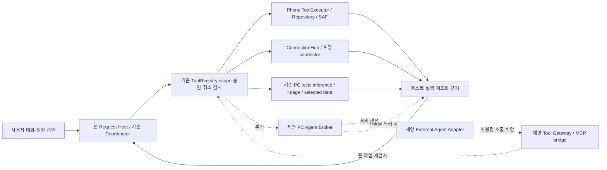

# 스마트폰 비서와 PC·외부 에이전트의 도구 실행 경계

문서 상태: **구조·전달 계약 설계, 제안 부분 미구현**. 작업 ID `TB-TOOLS-ARCH-03`. 작성 기준 2026-11-14 KST. 읽기 시작은 HEAD `8c3ed07f4c6ee7e7df3b1d62b486f309fac9757a`+1060 통합 변경이며, 최종 점검 중 통합 담당의1060 커밋 `f25a2e2b0382c72012e9a853dea841f50c519c93`을 확인했다. 이어 작성 중인 planner/compute 진단 변경은1060 설치 근거로 합치지 않는다. 이 문서만 소유하며 공유 소스·다른 문서·빌드·기기·모델·MCP 서버를 변경하거나 실행하지 않았다.

사용자 방향은 **스마트폰 비서를 기본으로 폰과 PC를 모두 다루고, PC에서 구동하는 외부 에이전트와 그 MCP 도구까지 통합 조율하는 것**이다. 기존 비서를 버리고 PC 개발 도구만 만드는 방향으로 바꾸지 않는다. 한 대화에서 요청·계획·도구·승인·정정·검증·결과를 이어가며, 사용자가 먼저 업무 모드를 선택하게 하지 않는다. 영속 목표는 명시 요청에만 만든다.

## 1. 기준선과 증거

| 층 | 이번 설계에서 사용하는 기준 | 해석의 한계 |
| --- | --- | --- |
| 등록 소스 | 현재 `ToolRegistry`와 조합되는 catalog 소스12개를 정적으로 읽어102개·이름 중복0을 확인했다. 본문 목록이 전체다. | 정적 이름 집계이며 새 실행·가용성 인증이 아니다. |
|1060 JVM·빌드 | 통합 담당 전달: core718/app603=1321 PASS, 릴리스 빌드 PASS. | 이 문서 담당은 재실행하지 않았다. 최종 source/asset/서명 해시는 통합 영수증을 따른다. |
|1060 설치·직접 폰 | 원래 채팅의 설치·해시 대조 완료 보고 및 신규 폰18/기존 회귀24 PASS 보고를 읽었다. | 직접 저장·파일·예약·범위 검사다. 실제 모델이 같은 복합 과제를 이해했다는 증거가 아니다. |
| 새 모델 복합 과제 | calculate_note/correct_note/reminder_lifecycle/file_typo/storage_report/capabilities의6개 chain 검증기는 준비돼 있으나 이 설계 기준에서 미실행이다. | 성공률이나 미실행 과제의 결과를 쓰지 않는다. |
| 과거1059 | 실제 모델/폰5종×2회 중 완료6, 확인 대기4라는 기록이 있다. |1060 새 모델 검증,102도구 전체 품질, 일반 업무 성공으로 올려 쓰지 않는다. |
| 외부 에이전트 | 개발용 `ziphap-local-llm` MCP 소스 및 별도 mock 검사 기록이 있다. | 폰→PC 에이전트 broker, 임의 MCP 사용, PC 전체 제어 완료가 아니다. |

공통 문서에 과거 checkpoint가 남아 있어도1060의 새 기록을 지우거나, 전달받은1060을 문서 담당이 독립 설치 검증했다고 표현하지 않는다. 제안 도구·protocol·모듈은 앞으로의 작업이며102개 현재 목록에 합산하지 않는다. 앱 이름·application ID·서명 identity를 유지한다.

## 2. 실행 권한은 폰의 불변 요청에서 시작한다



실선은 현재 존재하는 경로의 요약이며 모든 기능의 실증 표시는 아니다. 점선은 추가 설계다. 모델·외부 에이전트는 다음 행동을 제안하고 실제 실행은 등록된 host adapter가 한다. 생성된 JSON, 페이지, 파일, 메일, MCP 설명, agent summary는 권한 주체가 아니다.

폰 host가 현재 요청의 thread/branch/project, 원래 owner 요청, 읽기 전용·allowTools·disabledTools, workspace binding, pcDataBinding, kakaoReadBinding, capturedPcRevision/allowCloudText, 목표 버전, 실행 취소 generation을 캡처한다. 기존 큐의 제한은 새 UI·설정·에이전트 연결 때문에 넓어지지 않는다. 권한 변경이나 재페어링 이후 오래된 실행을 자동 승격하지 않는다.

PC 접속 권한, 폰 자료를 PC 로컬 모델로 보내는 권한, 외부 서비스/agent로 보내는 권한, PC 파일 수정, 폰 파일 수정은 서로 다른 권한이다. 현재 페어링이나 외부 agent 로그인만으로 다른 권한을 얻지 않는다. 이미 허용된 범위의 정상 작업은 같은 확인을 반복하지 않되, 대상·본문·효과·계정이 바뀌면 그 변경을 검사한다.

## 3. 공통 typed 계약

### 3.1 도구 제안과 권한 봉투의 분리

현재 `ToolCall(id,name,arguments)`는 유지한다. 모델은 name과 schema에 맞는 인자를 제안할 뿐이다. 향후 아래 내부 객체를 **host가** 붙여 adapter에 전달한다. 문자열 prompt에서 이런 객체를 복원해 권한으로 사용하지 않는다.

| 내부 타입(제안) | 필수 내용과 검증 |
| --- | --- |
| `ExecutionBinding` | 원래 request/run/thread/branch/project, request revision, scope epoch, cancel generation, goal version. 현재 DB live state와 일치해야 한다. |
| `ToolSpec` | 고정 name, schemaVersion, strict JSON schema, executor 종류, 효과 class, 지원 버전/한도, 필요한 grant, readback verifier ID. executable을 임의 문자열로 받지 않는다. |
| `ResourceRef` | owner가 선택하거나 실제 조회에서 발급한 opaque ID, origin, scope, observed version/hash, 전달된 원문 구간. raw URI/절대경로/계정 token은 model-visible 인자가 아니다. |
| `ExecutionGrant` | 대상 namespace·읽기/쓰기·전송 목적지·외부 agent·허용 tool·최대 효과·기한·예산의 교집합. server-side 보관, 불투명 handle만 전달하며 handle 소지만으로 scope 검사 생략 금지. |
| `ApprovalBinding` | 실제 대상·계정·정규화 인자 전체 hash·본문/첨부 hash·관찰 버전·grant revision·기한·단일 사용 상태. 승인은 모델이 채우는 true가 아니다. |
| `EffectLedger` | operation ID, 원래 요청과 승인, canonical argument hash, executor version, phase, remote/object ID, 결과 불확실 여부, readback receipt. 원문은 필요한 암호화 저장소에만 둔다. |
| `ExecutionReceipt` | 실제 adapter가 관찰한 action/status/effect/readback/coverage 및 발생 시점. 모델의 성공 문장과 구분한다. 요청·대상·버전·실행기와 묶어 저장한다. |

effect class는 최소 `CONTEXT_READ`, `PRIVATE_READ`, `PUBLIC_READ`, `PRIVATE_CREATE`, `PRIVATE_UPDATE`, `PRIVATE_DELETE`, `EXTERNAL_PREPARE`, `EXTERNAL_WRITE`, `EXTERNAL_SEND`, `LOCAL_COMPUTE`, `AGENT_DELEGATE`로 구분한다. 기존 Risk와 read-only 정책을 교체하기 전에 adapter metadata를 덧붙여 비교한다. 현재 LOW여도 analyze/checkpoint, 목표 생성처럼 내부 저장이 있을 수 있으므로 Risk.LOW를 무효과로 해석하지 않는다.

schema는 중복 키·추가 인자·타입 혼동·범위 초과·비정상 termination·알 수 없는 tool을 실행 전에 거부한다. 모델의 해석 오류를 키워드 라우팅이나 고정 답변으로 보완하지 않는다. 제한된 next-action 비교는 동일 schema·도구·권한·결과를 제공하는 별도 실험으로 하고 전역 선분류를 영구 전제조건으로 설계하지 않는다.

### 3.2 전체 도구에 적용되는 실행 순서

1. 원래 요청이 살아 있고 캡처된 범위·현재 권한·설정 revision이 일치하는지 검사한다.
2. strict tool schema를 검증하고, 자료 ID·선택 폴더·계정·workspace binding을 host에서 해석한다.
3. mutation이면 실제 대상을 읽어 사용자에게 필요한 요약을 만들고 원문 버전·본문과 승인을 묶는다. 모호한 대상은 독립 선택을 받으며 첫 후보를 기본 선택하지 않는다.
4. 같은 자원에 잠금을 잡고 실행 직전 scope/version/승인을 다시 검사한다. 실행 전 취소는 effect0이다.
5. effect ledger를 먼저 내구 저장하고 adapter를 호출한다. create/send 직전의 영속 상태가 없는 '재시도 가능' 응답을 만들지 않는다.
6. readback을 별도 경로로 확인하고 receipt를 저장한다. 저장 직후 취소도 이미 수행된 효과를 지우거나 미실행으로 바꾸지 않는다.
7. host의 관찰로 결과를 전달한다. `ActionCompletionReport`와 기존 evidence를 재사용하고 agent prose를 VERIFIED로 채택하지 않는다.

아직 전체 도구가 이 순서의 모든 제안 필드를 구현한 것은 아니다.1060은 기존 도구별 경계를 가진 기준선이며, 아래 profile 중 목표·외부 계정·프로젝트 파일의 강한 계약과 일반 메모 원문 수정의 공백을 구별한다.

### 3.3 권한·대상·승인·개인정보·취소·재실행·검증 profile

아래102개 표의 각 행은 input/effect/executor와 profile을 지정한다. 모든 profile에 공통으로 **모델 및 자료는 untrusted**, 원문/ID/URI/주소/키는 공개 진단·Git 제외, 현재 권한/취소 재검사, 부분 결과 범위 보존을 적용한다. 이 상속을 생략해 '목록에 있음=허용'으로 구현하지 않는다.

| Profile | permission / target proof / approval | privacy / cancel / idempotency / readback |
| --- | --- | --- |
| A 순수 계산·문맥 | 등록 tool∩현재 허용 집합. 입력 수식·구간·번들 지침 ID만 허용. 순수 계산/읽기에 별도 mutation 승인 없음. | 계정·폰 자료를 자동 읽지 않는다. 취소하면 후속 실행0. 재계산 가능하지만 새 시각은 새 observation. 번들 hash, 계산기 실제 결과를 확인하며 skill 읽기를 업무완료로 세지 않는다. |
| B 폰 provider·저장자료 읽기 | Android runtime grant 및 해당 source scope. 실제 provider/query/선택 ID를 host가 결정. 읽기 허용은 쓰기 승인이 아니다. | 최소 field·bounded excerpt·source hash/시각/coverage. 취소/철회 즉시 다음 읽기 중단. 읽기 재시도 가능하되 stale 데이터를 새 조회로 표시하지 않는다. count/metadata/발췌와 전체 분석을 구분한다. |
| C 메모·기억 | 현재 repository scope, 내부 collection 차단. 명시 기억/삭제 요청, 중위험 create/update의 기존 범위 승인, delete의 별도 확인. 실제 ID·title·group/version으로 검토한다. | encrypted Room. 저장/readback 동일성 확인.1060 mutation preview/CAS를 유지한다. 긴 note의 모델 전달 원문·부분 patch는 아직 공백이며 §7의 신규 계약이 필요하다. 전송/학습/공개 검색 권한을 만들지 않는다. |
| D 앱 리마인더 | 현재 reminder scope와 group을 별도 검사. 실제 ID/version/CAS, 미래 ISO-offset 시각. 삭제 전 기존 존재 확인. create/update 승인 및 delete 확인. | scheduler mutation과 delivery 잠금. 같은 요청 기록을 재사용하고 불명확한 create를 재생성하지 않는다. DB·예약 큐·revision·표시권한·실제 게시를 분리한다. 실패/취소 때 부분 effect를 기록한다.1060의 queue-state 검사만으로 정시 도착을 보증하지 않는다. |
| E 외부 화면 준비 | 설치 handler 및 현재 요청의 대상 proof. SMS는 현재 요청 명시 번호 또는 실제 조회 후보+독립 선택, 본문 묶인 승인. Calendar/Clock/mail은 최종 값을 검토한다. | Intent 인계 이후 PREPARED로 멈춘다. 수신/저장/발송/길안내를 단정하지 않는다. 같은 실행의 반복 Intent 금지. 취소가 다른 앱에 이미 열린 초안을 제거했다는 뜻이 아니다. |
| F 폰 프로젝트 파일 | owner-selected private/SAF root·workspace binding·해당 권한. relative path만. 기존 overwrite는 현재 실행에 전달된 전체 원문 proof+정확 SHA, 필요한 쓰기 승인. | provider/alias mutation lock, traversal 차단. bounded 읽기·해시. write/readback 및 실패 복구 경계를 유지한다. audit hash는 편집 토큰이 아니다. 이동/삭제는 현재 없음. SAF 재선택·철회·동시변경은 새 실행 필요. |
| G 새 private 산출물 | 현재 요청의 명시 형식/title/content, 고정 exporter. 임의 output URI/덮어쓰기/전송 없음. 앱 내부 신규 생성의 기존 정책을 유지하고 export는 별도 사용자 동작이다. | 고유 파일+owned-temp 정리. 실제 형식별 readback, 부분 파일을 완료로 전달하지 않는다. 동일 operation artifact 재사용은 ledger 구현 후 보장한다. 현재 요청 재시도 전체의 exactly-once를 주장하지 않는다. |
| H 공개 조사 | 공개 질의/HTTPS 입력, 사설주소·credentials·unsafe redirect 거부. private source를 검색어로 내보내는 권한은 별도다. | URL/title/fetch time/범위, 원문은 untrusted. bounded network/cancel. 읽기는 재시도 가능하나 변동 시점 표시. 가격/재고/최저가·서지 결론을 관찰 이상으로 확대하지 않는다. |
| I 계정 connector | 별도 로그인·service scopes·고정 principal/generation·read/write grant. 실제 object ID와 계정. write는 정확 payload 승인, Gmail send/reply는 정확 sender/recipient/full body의 단일 승인. | token은 executor 보관. request-start ledger와 remoteId/readback. 불확실한 write/send는 reconcile 전 재전송 금지. 취소 이후 원격 효과 여부 불명은 UNKNOWN으로 남긴다. 조회도 계정 변경/철회를 재검사한다. |
| J PC 선택자료·NotebookLM | 별도 pc-tools 허용, 원래 paired identity/pin, thread/source binding. 표 파일은 선택한 content hash; NotebookLM은 실제 허용 notebook ID, query는 서비스 전송 효과이므로 별도 확인. | 표 byte만 authorized paired PC로, notebook 질문은 NotebookLM에 전달됨을 표시. requestId/serverId/sourceHash 재검사. cancel 후 chart를 받았다고 원래 파일을 바꾸지 않는다. 계정 준비·자료 정확도는 별도이며 외부 모델 호출을 로컬 추론으로 표시하지 않는다. |
| K 개인 분석·전사 | 현재 source 목록/opaque recordingId/analysisId·hash·진행 version, Android/source 허용. 분석 질문과 원래 기간 유지. 자동 메시지·일정·기억 effect 없음. | encrypted chunks/checkpoints, 원음 보존. 현재 recording tool은 `deviceOnly=true` ASR 경로이며 일반 PC-text와 다르다. 모델/자료 lease 직렬화, 취소·미완성 notes 정리, resume CAS. ASR·인용 일치와 의미·화자 정확도는 다르다. |
| L 목표 lifecycle | 현재 thread/project, 명시 영속 목표 요청, 실제 goalId/version. 수정은 전체/부분 원문 전달 증거. start/resume/pause/clear는 명시 요청과 기존 effect 정책. | 기존 GoalStore/CAS·run quiesce·scope 유지. enqueue는 완료가 아니고 deferred caller stop은 PREPARED. 삭제는 목표 상태만 지우며 이미 수행한 외부 효과를 취소하지 않는다. |
| M 이미지 계산 | 현재 run/model/reference binding·captured PC revision. 명시 PC 선택은 PC 실패 시 중단. 별도 phone 이미지 선택 경로는 보존. 원래 recovery opt-in 유지. | 장면/선택 reference만 계산, cloud API 불필요. one engine lease. PNG 실제 저장/metadata/hash 뒤 ACK. 원래 image job의 status/resume/owner를 재사용하며 단절과 명시 취소를 구분한다. |
| N 제한 화면·알림 reply | 앱별 opt-in+Android 접근, 현재 notification action/버전 adapter, live 요청. reply는 정확 대상·본문 high-risk 확인. 화면은 개인 profile/전경/지원 버전만. | 알림은 bounded session, 전체 이력 아님. 화면 본문도 지시 권한 없음. reply 전송 요청과 전달 확인을 분리, stale notification 재사용/중복 발송 금지. 접근성으로 보호 프로필·잠금·시스템 승인을 우회하지 않는다. |
| O 환경 진단 | 등록∩현재 allowedTools와 metadata만. 권한 자동 획득·health/model prepare·설정 변경 없음. | PC등록≠reachability, cached verified records≠runtime ready. unknown은 UNVALIDATED/UNCONFIRMED. `partial`은 허용 집합 중 출력 생략이며 미허용 등록 도구 수와 다르다. URI/경로/주소·토큰 출력 없음. |

## 4. 현재102개 도구의 실행 지도

각 도구의 타입·필수/선택 인자와 숫자/길이 한도는 연결된 catalog의 strict validator가 정본이다. 아래 `?`는 선택 인자, `OffsetTime`은 명시 offset이 있는 ISO 시각, `Ref`는 실제 조회·선택된 ID/hash다. 표는 확정 schema를 새로 발명하지 않고 의미와 route를 드러낸다. 추가 인자는 제안 도구에서만 도입한다.

### 4.1 기본 registry38개

| # | 도구 / typed input 핵심 | 실제 실행 위치·효과 | 계약 |
| --- | --- | --- | --- |
|1|`get_current_datetime()`|폰 clock 조회, Asia/Seoul|A|
|2|`list_project_files(path?:relative)`|폰 private/SAF immediate children100개|F 읽기|
|3|`read_project_file(path:relative)`|폰 bounded UTF-8·SHA·read token, 모델 전달 excerpt 별도|F 읽기|
|4|`write_project_file(path,content,expectedSha256?)`|폰 신규/검증된 기존 텍스트 쓰기·readback|F 변경|
|5|`create_document(format,title,content)`|폰 DOCX/XLSX/PDF/TXT/CSV 새 private 파일|G|
|6|`search_web(query:public)`|폰이 공개 자료 수집, 로컬 모델이 선택/종합할 수 있음|H|
|7|`search_shopping(query,store?)`|폰 공개 상품 링크·관찰가격 수집|H|
|8|`read_webpage(url:https)`|폰 bounded public fetch|H|
|9|`generate_image(prompt,negativePrompt?,steps?,seed?)`|폰이 job/결과 소유, 선택된 paired-PC 로컬 diffusion 또는 명시 phone image engine|M|
|10|`search_conversation_history(query?,limit?)`|폰 ZipHap 자체 현재 범위 기록 발췌|B|
|11|`list_imported_conversations()`|폰 owner가 가져온 파일 metadata|B|
|12|`search_conversation_imports(query?,contentSha256?,limit?)`|폰 실제 import의 부분 발췌|B|
|13|`get_sms_summary(query?,start?,end?,limit?)`|폰 SMS 통계·최대5 발췌|B READ_SMS|
|14|`get_call_log_summary(query?,start?,end?,limit?)`|폰 통화 메타데이터·마스킹 발췌|B READ_CALL_LOG|
|15|`list_audio_recordings(query?,limit?)`|폰 MediaStore metadata, 현재 요청 opaque recordingId 발급|B MEDIA_AUDIO|
|16|`search_audio_transcripts(query?,limit?)`|폰 기존 전사 notes의 부분 검색|B|
|17|`list_calendar_events(start,end,calendarId?)`|폰 calendar provider, start inclusive/end exclusive|B READ_CALENDAR|
|18|`prepare_calendar_event(title,start,end,description?,location?)`|폰 Calendar INSERT Intent, 실제 저장 미확인|E|
|19|`create_reminder(title,datetime,scope?)`|폰 encrypted record+AlarmManager/WorkManager 예약|D|
|20|`list_reminders(scope?,limit?,includeCompleted?)`|폰 현재 자료 범위 record/status 조회|D 읽기|
|21|`get_agent_capabilities()`|폰 metadata snapshot, 네트워크·모델 실행0|O|
|22|`create_alarm(hour:int,minute:int,label?,days?:int[])`|폰 Clock Intent, 설정 완료 미확인|E|
|23|`save_note(content XOR contentQuoteId,title?,scope?)`|폰 literal-reference 해석 후 encrypted note 쓰기|C|
|24|`search_notes(query,scope?,limit?)`|폰 일반 note 최대5·본문1000자 발췌|B/C|
|25|`search_contacts(query,limit?)`|폰 실제 연락처 이름/번호 후보 조회|B READ_CONTACTS|
|26|`prepare_sms(phoneNumber,message)`|폰 ACTION_SENDTO, 실제 발송 없음|E 대상선택|
|27|`prepare_email(to,subject,body)`|폰 mail Intent, 서버 draft/send 아님|E|
|28|`open_map(query)`|폰 geo Intent, 길안내 시작 아님|E|
|29|`open_url(url:https)`|폰 browser Intent, 페이지 읽기 아님|E/H|
|30|`save_memory(content,kind?)`|폰 명시된 안정적 owner 사실 저장|C|
|31|`search_memories(query,limit?)`|폰 허용 기억 검색|B/C|
|32|`delete_memory(id:Ref)`|폰 실제 기억·연결 근거 제거|C 삭제|
|33|`update_note(id,content,title?,scope)`|폰 기존 note 전체 본문 교체·readback|C 원문 공백 주의|
|34|`update_reminder(id,scope,title?,datetime?)`|폰 version-bound save→cancel→schedule|D|
|35|`delete_note(id:Ref)`|폰 실제 기존 note·연결 근거 삭제|C 삭제|
|36|`delete_reminder(id:Ref)`|폰 version-bound DB delete→예약 cancel|D 삭제|
|37|`list_messenger_notifications(packageName,limit?)`|폰 허용 앱 session notification만 읽기|N 읽기|
|38|`reply_messenger_notification(id:Ref,message)`|폰 현재 알림 reply action으로 실제 전송 요청|N send|

### 4.2 외부 계정 connector28개

아래는 **폰 `RequestConnectionExecutor→ConnectionHub→core ConnectionRuntime`이 고정 API를 호출**하는 현재 경로다. 외부 에이전트나 임의 MCP가 실행하는 도구가 아니다. 서비스 응답은 untrusted 자료이며 계정별 scope와 generation을 검사한다. 전부 profile I를 상속한다.

| # | 도구 / typed input 핵심 | 외부 효과·target proof·readback 세부 |
| --- | --- | --- |
|39|`search_drive_files(query)`|Drive filename/metadata search, 전체 파일 내용 아님|
|40|`read_drive_text_file(id:Ref)`|선택한 non-native UTF-8 파일 읽기; native Docs와 구분|
|41|`create_drive_text_file(title,content)`|새 private 파일 create+정확 text readback, 공유/overwrite 없음|
|42|`read_google_document(id:Ref)`|해당 Docs 문서 읽기|
|43|`create_google_document(title,content)`|새 private Docs 생성·body readback|
|44|`read_google_sheet(id:Ref,range?)`|bounded Sheets range 읽기|
|45|`create_google_sheet(title,rowsJson:string)`|최대100×30 문자열 배열 JSON, RAW 값 create/readback|
|46|`read_google_presentation(id:Ref)`|해당 Slides 읽기|
|47|`create_google_presentation(title,content)`|새 private 한 슬라이드, body readback; 공개 없음|
|48|`search_gmail_messages(query)`|Gmail ID 검색, 본문은 별도 read|
|49|`read_gmail_message(id:Ref)`|현재 계정 실제 메일 bounded 본문, HTML·첨부 실행 없음|
|50|`create_gmail_draft(to,subject,body)`|서버 draft 저장·재조회, 발송 없음|
|51|`send_gmail_message(to,subject,body)`|sender까지 exact preview, 실제1건 send·SENT/readback, 불확실 재전송 금지|
|52|`reply_gmail_message(messageId:Ref,to,body)`|원본 thread/header/Reply-To·From/subject 재검사 후 실제 reply; no Cc/Bcc|
|53|`list_google_calendar_events(start,end,calendarId?)`|허용 계정·지정 offset 구간 조회|
|54|`create_google_calendar_event(title,start,end,calendarId?)`|실제 계정 일정 create/readback, 참석자·초대 없음|
|55|`list_google_tasks()`|기본 task list의 bounded 목록|
|56|`create_google_task(title,notes?,dueDate?:date)`|실제 task create/readback; dueDate는 알람 시각 아님|
|57|`complete_google_task(id:Ref)`|해당 task 완료 상태 변경·재조회|
|58|`search_google_contacts(query)`|별도 Google 계정 contacts 조회, 폰 연락처와 다름|
|59|`read_google_form(id:Ref)`|Form 질문/metadata, response 아님|
|60|`list_google_form_responses(id:Ref)`|허용 Form의 bounded 개인 응답 읽기|
|61|`create_google_form(title,questionsJson:string)`|최대10개 plain text 질문, private create/readback; 배포 아님|
|62|`search_youtube_videos(query)`|동영상 metadata, 영상·자막 다운로드 아님|
|63|`list_youtube_playlists()`|허용 계정 user playlist 일부, 전체 시청기록 아님|
|64|`list_telegram_bot_updates()`|설정 bot+허용 chat 범위만, owner Telegram 전체계정 아님|
|65|`search_notion_pages(query)`|해당 integration과 공유된 page 검색|
|66|`list_todoist_tasks()`|연결이 볼 수 있는 active task 일부|

### 4.3 PC 전용 연결4개와 소비자 앱9개

PC 분석은 `PcToolClient→PcTransport→/v1/tools/...`이며 현재 inference worker의 일반 text endpoint와 동일 기능으로 취급하지 않는다. 저장소의 `pc-worker/deployed`는 배포 compute 스냅샷이다. 분석 서비스의 실제 배포 상태는 별도 inventory/검증을 읽어야 하며 이 소스에 서비스 파일이 전부 들어 있다고 가정하지 않는다.

| # | 도구 / typed input 핵심 | 실행 위치·효과 | 계약 |
| --- | --- | --- | --- |
|67|`analyze_selected_data(mode?,optionsJson?)`|선택 표 bytes를 paired PC에서 profile/statistics/regression/cluster/chart; 임의 코드 아님|J|
|68|`query_selected_data(sql,optionsJson?)`|선택 파일의 table data read-only DuckDB SELECT, 외부file/network 차단|J|
|69|`list_notebooklm_notebooks()`|PC의 별도 NotebookLM 로그인으로 목록 읽기|J 외부서비스|
|70|`query_notebooklm(notebookId:Ref,question)`|NotebookLM에 질문을 보내 새 대화; sources 변경 없음|J 확인 필요|
|71|`open_tmap(query?)`|폰 TMAP/장소 Intent, 운전 시작 없음|E|
|72|`open_tmap_destination(name,latitude:string,longitude:string)`|실제 관찰 좌표의 destination Intent, WGS84 범위 검사|E 좌표 proof|
|73|`open_netflix()`|폰 설치 앱 열기, 구독/시청정보 조회 없음|E|
|74|`search_netflix(query)`|공식 검색 링크·browser fallback, 재생 확인 아님|E|
|75|`open_netflix_title(id:numeric-string)`|공식 title page Intent|E|
|76|`open_coupang()`|폰 앱 열기, 장바구니/주문/결제 없음|E|
|77|`search_coupang(query)`|공식 검색 링크, 실제가격 검증 아님|E|
|78|`open_coupang_product(id:numeric-string)`|공식 product page, 구매 없음|E|
|79|`open_coupang_eats()`|폰 앱 열기, 주문·결제·주문내역 조회 없음|E|

### 4.4 지침·계산·분석·목표·저장소23개

| # | 도구 / typed input 핵심 | 실행 위치·효과 | 계약 |
| --- | --- | --- | --- |
|80|`list_skills(query?)`|폰 signed bundle metadata|A 문맥|
|81|`read_skill(id:catalog-id)`|폰 hash-checked 전체 지침; 새 권한 없음|A 문맥|
|82|`calculate(expression,decimalPlaces?:int)`|폰 bounded decimal 산술, code/functions 실행 없음|A|
|83|`date_calculate(operation,date,days?:int,otherDate?)`|폰 ISO date 덧셈/차이, workweek 추측 없음|A|
|84|`find_free_time(start,end,timeZone,busy:interval[],allowed?:interval[],durationMinutes,bufferMinutes?,limit?)`|폰 주어진 구간 계산만; 실제 calendar는 별도 조회|A|
|85|`search_publications(query,originalQuery?,limit?)`|폰 Europe PMC 공개 metadata/abstract|H|
|86|`verify_reference(doi XOR citation,limit?)`|폰 Crossref 후보/DOI 조회, 논문 결론 검증 아님|H|
|87|`list_analysis_sources(kind?,limit?)`|폰 현재 범위 source metadata·ID|K 읽기|
|88|`analyze_sms(question,start?,end?,maxChunks? OR resume)`|폰 SMS snapshot/checkpoint·현재 요청 model engine 분석|K|
|89|`analyze_audio_transcript(transcriptId,question,maxChunks? OR resume)`|폰 저장 transcript/chunks와 로컬 model engine 분석|K|
|90|`analyze_conversation_import(contentSha256,question,maxChunks? OR resume)`|폰 import chunks와 로컬 model engine 분석|K|
|91|`read_analysis_evidence(analysisId,evidenceId? XOR offset?/limit?)`|폰 원자료/hash/quote span 재검사·상세 page|K 읽기|
|92|`transcribe_recording(recordingId:current-ref)`|폰 현재 목록 recording을 `deviceOnly` ASR·encrypted transcript/chunks; PC raw 전송 아님|K|
|93|`get_goal(criteriaOffset?,criteriaLimit? OR text fragment selector)`|폰 현재 대화 goal 원문/기준 page|L 읽기|
|94|`create_goal(outcome,criteria:string[],constraints?:string[])`|폰 DRAFT 저장, 작업 시작 없음|L|
|95|`update_goal(goalId,expectedUpdatedAt,fields? OR textEdits[])`|폰 version-bound 전체/부분 goal 수정·원문 전달 proof|L|
|96|`start_goal(goalId,expectedUpdatedAt)`|폰 명시 목표의 bounded run 한 번 enqueue|L|
|97|`pause_goal(goalId,expectedUpdatedAt)`|폰 linked run quiesce→PAUSED, deferred stop 별도|L|
|98|`resume_goal(goalId,expectedUpdatedAt)`|폰 PAUSED goal 한 번 enqueue, 기존 권한 유지|L|
|99|`clear_goal(goalId,expectedUpdatedAt)`|폰 goal CAS-delete, 대화/외부effect 취소 아님|L 삭제|
|100|`read_kakao_screen()`|폰 지원버전 개인 전경 화면을 제한 읽고 원대화 복귀|N 읽기|
|101|`inspect_project_storage(path?:relative)`|폰 선택 root의 크기/상위파일/확장자 metadata, whole-phone 아님|F 읽기|
|102|`find_project_duplicates(path?:relative)`|폰 실제 size+SHA 일치, depth4/500·16MiB/file·64MiB hash; visual similarity·삭제 없음|F 읽기|

`resume`는 실제 analysisId와 expectedProcessedChunks(+maxChunks?)만 받는 기존 계약이다. 모델 분석의 일반 text engine은 현재 paired-PC local 경로를 쓸 수 있지만 원자료 접근·snapshot·evidence는 폰이 소유한다. 이 때문에 '폰 도구'와 '추론 연산 위치'는 같은 열로 합치지 않는다.

현재102개 중 **범용 external-agent submit/control tool은0개**다. 외부 Codex/Claude→개발용 로컬 LLM MCP의 `local_status/local_ask/local_digest_files/local_batch` 네 개는 별도 개발 호스트 도구이며 Android102개에 포함하지 않는다. 앱 개인 브리핑의 외부 Codex 분석은 별도 opt-in 파이프라인이며 일반 MCP 도구를 우회 활성화하는 경로가 아니다.

## 5. 기존 실행기를 유지하는 모듈 경계

| 현재 정본 / 재사용할 자산 | 다음 추가 책임 | 금지되는 합침 |
| --- | --- | --- |
| `core/Tools.kt`, catalog, ToolReadPolicy, AgentWorkModePolicy | versioned ToolSpec/provenance/effect metadata를 덧붙이고 기존 validator와 차등검사 | '모든 도구 실행' 단일 JSON/shell escape hatch, 키워드 intent interpreter |
| `ChatRunCoordinator`, `QueuedChatRequest`, TaskHarness, WorkSegments | request-bound dispatcher와 external job wait/resume를 작은 host service로 분리 | 전체 coordinator rewrite, 큐 deserialize 시 새 설정/권한으로 보충 |
| `app/tools/ToolExecutor.kt` | PhoneExecutor facade. 실제 provider/Repository/Intent/SAF 호출과 현재 preview/CAS 검사를 계속 담당 | PC가 raw URI/record ID를 정하면 바로 실행, model output으로 SYSTEM/USER 증거 생성 |
| `ProjectWorkspace`, WorkspaceMutationLocks | resource handles·부분 원문 proof·선택 폴더 버전; SAF는 계속 폰이 resolver 소유 | URI를 PC 절대경로로 간주, 다른 tree/alias/프로필로 fallback |
| `ConnectionHub`, RequestConnectionExecutor, core ConnectionRuntime/GmailSendRuntime | account effect adapter의 정본. broker 요청도 원래 run 검사를 거쳐 여기에 도착 | agent에게 OAuth token/로그인 세션 복사, browser로 승인·계정 boundary 우회 |
| `PcComputeSettings/PcTextAuthority/PcTransport`, AutomaticComputeEngine | pin/원래 identity/authority revision/lease를 유지하는 연결·연산 기반 | health=새 tool 권한, cloud 설정=외부agent 데이터 반출 승인 |
| `PcToolClient` 및 기존 PC 분석 endpoint | 선택파일 분석 J profile 유지. 제안 `PCConnector` facade가 capability별 client를 주입 | 존재하지 않는 `PcConnector` 클래스를 현재 구현이라고 기술, 분석 service와 compute worker 배포를 혼동 |
| `pc-worker/deployed`, model/image resource gate | GPU/모델 owner lease와 검증된 기존 compute 호출 유지 | broker 추가 때문에 model/worker를 실행 중 재시작하거나 weight를 APK/Git에 포함 |
| 새 `pc-agent-broker`(제안) | job ledger·capability lease·isolated agent process·artifact ingress/egress·typed effect gateway | existing development MCP를 공개 LAN 범용 command server로 노출 |
| 새 `ExternalAgentAdapter`/`McpAgentAdapter`(제안) | 고정 adapter ID/version, handshake/tool schema pin, toolset 제한, session·cancel/event protocol 변환 | MCP 이름/description만으로 신뢰·설치·가용성 판단, 동적 endpoint/임의 executable/환경변수/credential 전달 |

`PCConnector`는 새 포괄 실행권이 아니라 이 client들의 typed facade 명칭이다. 실제 현재 code symbol은 `PcToolClient/PcTransport`다. 외부 에이전트 호스트가 지원하는 실제 API/CLI/MCP 기능과 취소 보장은 adapter 구현 전 해당 owning source로 확인하고 version을 고정한다. 본 설계는 특정 제품의 원격 제어 API가 이미 존재한다고 가정하지 않는다.

처음에는 `core`에 Android 없는 DTO/검증기를 추가하고 `app`의 기존 executor를 감싸며, PC broker는 별도 프로세스·테스트 묶음으로 둔다. 나중에 모듈을 나눌 때도 app→core, app→typed client, broker→adapter/gateway 방향만 허용한다. 모델 런타임·signing·build 환경을 함께 갈아엎는 변경은 하지 않는다.

## 6. 폰 SAF와 PC workspace mapping

### 6.1 선택과 mapping

폰의 선택 tree는 PC 드라이브가 아니다. 새로운 `WorkspaceMapping`(제안)은 phone project scope·workspace binding, PC에서 사용자가 선택한 root handle·root identity, 방향(`READ_SNAPSHOT`, `PROPOSE_PATCH`, `APPLY_APPROVED_PATCH`), 허용 상대 prefix, 파일/총byte 한도, conflict policy, grant revision을 묶는다. raw tree URI와 PC 절대경로는 양쪽 host 비밀 저장소에만 둔다. 모델과 agent에는 `workspaceRef`와 논리 상대경로만 제공한다.

폰 파일→PC 작업은 host가 실제 선택/읽기 가능한 파일의 `resourceRef/hash/byteLength` manifest를 만든 뒤 private staging snapshot을 전송한다. snapshot은 원본에 대한 mount가 아니다. PC에서 고친 결과는 artifact/patch 제안으로 돌아오고 폰 host가 최신 source hash·SAF 권한·승인·문맥 전달 proof를 다시 검사한 뒤 반영한다. 양방향 자동 동기화는 기본값으로 추가하지 않는다.

PC 원본 project를 직접 다룰 때도 사용자가 PC native picker에서 선택한 root가 있어야 한다. 폰 프로젝트와의 mapping은 owner가 보는 이름으로 연결하며 요청 중 root 재선택은 기존 lease를 무효화한다. '현재 PC 폴더'나 external agent의 이전 working directory를 암묵 root로 삼지 않는다.

### 6.2 해석·실행 경계

- 논리 경로는 `ProjectPaths.segments`와 호환되는 bounded relative path만. 절대경로·drive/UNC/device prefix·colon/alternate stream·역슬래시·NUL·`.`/`..`·인코딩 우회를 먼저 거부한다. percent decoding을 반복해 escape를 허용하지 않는다.
- PC executor는 OS handle의 실제 부모·volume/file identity를 검사한다. symlink/junction/reparse-point/hardlink alias로 허용 root 밖 파일을 바꿀 수 있으면 쓰기를 거부한다. 문자열 canonical prefix만으로 race-safe containment를 보장했다고 하지 않는다. 지원 OS에서 안전한 no-follow/relative-handle primitive가 검증되기 전에는 위험한 alias write를 열지 않는다.
- staging artifact는 개별 entry별 상대경로·종류·크기·hash를 검증하고 고정 root 아래 새 파일로만 받는다. archive/압축 해제·실행권한·link 복원은 첫 단계에 지원하지 않는다. artifact name은 실행 명령이 아니다.
- SAF는 Android resolver/Document ID/지속 grant를 폰에서 해석한다. 같은 provider alias와 중복 display name을 검사하고 권한 상실·provider partial 기능은 명시 실패한다. PC는 `content://`를 직접 열지 않는다.
- whole-phone, `/data`/앱 private, 업무 프로필, 잠금·보안 화면·시스템 권한을 ADB/shell/root/다른 profile 복사로 우회하는 제품 도구를 만들지 않는다. 개발 ADB 허가는 제품 agent의 실행 권한이 아니다.
- PC 제어도 owner의 허용 OS 계정·app·window·workspace 안에서 version-bound typed adapter로 확장한다. UAC/보안 prompt/로그인·비밀번호·결제·관리자 승격을 자동 통과시키지 않는다. 일반 agent에게 무제한 desktop/mouse/keyboard를 주고 안전하다고 표시하지 않는다.

### 6.3 파일 변경 commit

파일 단위 `operationId + expectedHash + expectedResourceVersion + mappingRevision`를 검사한다. write preview는 모델이 본 patch와 실제 결과물의 diff를 사용한다. PC 원본 변경과 폰 반영을 하나의 원자 transaction으로 약속하지 않는다. 둘 중 하나가 실패하면 각 side의 적용/미적용 상태와 hash를 남기고 충돌을 표시한다. 자동으로 상대편 최신본을 덮어써 수렴시키지 않는다.

여러 파일 변경은 먼저 모두 validate/preview한 manifest를 받고 파일별 commit receipt를 남긴다. 불완전 적용은 `PARTIALLY_APPLIED`이며 '실패했으니 아무것도 안 바뀜'이 아니다. rollback 가능성을 실제 provider/OS별로 검증하고, 보장할 수 없으면 승인 전에 부분 적용 한계를 보인다.

## 7. 빠진 도구와 additive 우선순위

아래 이름·schema는 **제안**이다. 등록·설치·검증됐다고 표시하지 않는다. 기존 connector에 같은 효과가 있으면 신규 도구를 만들기 전에 그 경로를 재사용한다.

| 순서 | 도구·typed input 제안 | effect/permission·target proof·approval | privacy·cancel·idempotency·readback / 통과 조건 |
| --- | --- | --- | --- |
| P0 기반 | `read_note(id,expectedVersion?,offset,limit)` | scoped private read. 현재 실제 note ID와 버전, 금지 collection 거부. 저장 authority 부여 없음. | bounded exact text/nextOffset/hash와 host 발급 delivered-span proof. 읽지 않은 tail이 있음을 표시.1000자 이후·개행·emoji·변경/삭제·scope 회귀. |
| P0 기반 | `patch_note(id,expectedVersion,edits:[{oldText,newText}],title?)` | C update. oldText는 현재 요청에 실제 전달된 같은 버전 구간에서 유일 match. 중복match/미관찰/CAS충돌 거부. preview diff+기존 승인. | 원본을 host에서 patch하고 나머지 byte/text 보존. operation ledger 후 commit/readback. 취소·경합 뒤 재읽기/재승인, 자동 전체교체 fallback 없음. |
| P0 기반 | `read_project_file_range(resourceRef,expectedHash,offset,limit)` / `patch_project_file(...)` | F. 현재8,000자 모델 excerpt 이후의 안전한 부분수정 공백 해소. 기존 read token을 버리지 않고 span proof를 확장. | 실제 전체 파일·미전달 영역 보존, hash가 바뀌면 중단. binary 수정/임의 byte offset 쓰기는 별도 미지원. 기존 read/write semantic 유지. |
| P0 전제 | `list_agent_adapters()` / `inspect_agent_adapter(adapterRef)` | host 등록·현재 허용·실제 handshake/격리/지원tool/사용량 구분. discovery가 실행·설치 권한 아님. | metadata만, secret/address 출력0. schema/version drift는 UNVALIDATED. current capabilities와 동일 partial=허용집합 내 생략 계약. |
| P1 첫 위임 | `submit_agent_task(adapterRef,task,resourceRefs[],budget,expectedAdapterRevision)` / status / cancel | AGENT_DELEGATE. 목적·데이터·허용tool/effect·workspace의 교집합, 독립 agent-export grant. 첫 단계 read-only/advisory만. | 별도 job ledger/세션, owner cancellation, 기한/결과 용량·hop 제한. tool/환경 제한을 강제 못하는 agent는 execution adapter로 등록하지 않는다. artifact 검증은 §8. |
| P1 PC workspace | `list_pc_files(workspaceRef,path?)`, `read_pc_file(resourceRef,...)`, `propose_pc_patch(...)` | owner-selected root mapping. 기존 pc selected-data 분석과 별개 grant. PC 위치·version proof와 preview. | snapshot/manifest/hash, no shell/absolute paths, PC original write는 별도 host apply. link escape와 alias 회귀 필수. |
| P1 안전 정리 | `plan_project_move(resourceRefs[],destinationRef)` / `apply_project_move(planId)` | F에 move effect 추가. 실제 source/dest/version·동일root·없던dest 확인; 파일별 preview+명시 승인. | atomic rename 지원시만 같은 root rename. SAF copy+delete는 별도 effect/부분 상태이며 초기에 금지 가능. 해시·존재·원본제거 재조회. 다른 기기 mapping 변경이면 거부. |
| P1 안전 정리 | `plan_project_delete(resourceRefs[])` / `apply_project_delete(planId)` | 실제 관찰·선택 파일만. storage duplicate report 자체는 삭제 승인 아님. high-risk exact set preview, root/directory 재귀삭제는 첫 단계 제외. | 가능하면 검증된 quarantine/trash 후 확정 삭제 분리. SAF 지원 없으면 명시영구삭제/보류. 중간 취소·실패 파일별 ledger, 불확실 delete 재실행 금지. 실제 owner 파일로 QA하지 않음. |
| P1 일정 | `create_phone_calendar_event(calendarRef,title,start,end,...)` | 기본 일정 UI 준비와 다른 직접 provider write. WRITE_CALENDAR·실제 calendar/계정 선택·정확 preview. 현재 `create_google_calendar_event`는 이미 있음. 브리핑 CalendarGateway의 insert/readback/dedupe를 일반 요청에 안전하게 재사용. | ID/field readback, attendees/invite 기본금지, 동일operation 중복0. 나중 update/delete는 actual event version/owner 선택·충돌·외부 sync를 따로 검증. 다른 계정을 몰래 선택하지 않음. |
| P2 가격 감시 | `create_price_watch(productRef,variantRef,condition,currency,schedule,budget)` / list / pause / delete | 현재 search_shopping을 주기 실행으로 오해하지 않음. 명시 영속 감시·공개 endpoint·정확 상품/옵션·최대횟수·만료·알림 grant. | WorkManager 최소간격·PC필요 여부·누락기간·실패 quota 공개. 관찰가격만 비교, stale/옵션변경 제외. 알림 event dedupe, 자동구매0, 지속접속/유료API/우회수집0. 감시가 아직 없으면 미지원 유지. |
| P2 제한 제어 | `prepare_app_action(adapterRef,targetRef,action,args)` / exact apply | 폰/PC 각각 user-driven version-bound adapter. package/window/version/관찰 node proof, input/click typed allowlist, 위험 action 분리 승인. | 관찰→승인→동일snapshot 검사→한번실행→독립 readback. 화면변경/UAC/보호영역은 중단. TMAP 화면 열기를 navigation-start로 승격하지 않음. |
| 후속 | `run_workspace_check(checkProfileRef,inputManifestRef)` | 임의 shell 대신 서명/검토된 고정 check profile과 allowlisted executable+정확 argument schema. workspace 격리·resource/network/child-process 제한. | 기존 PC 분석기로 안 되는 실행만. timeout 후 자식정리, stdout은 untrusted, exit code와 산출물 hash 별도. 실제 격리/동시 작업 보존·도구chain 검증 후 도입. |

read_note/patch_note와 리마인더의 queue revision·재예약 실패 reconcile은 PC 오케스트레이션보다 앞서 정상 비서 업무 손실을 줄이는 기반이다. 가격 감시·파일 정리·desktop 제어는 동시 추가하지 않고 각 effect 경계가 검증되는 순서로 연다.

## 8. 미래 MCP/외부 agent adapter 계약

### 8.1 등록과 격리

외부 agent는 `adapterId/version`, 설치 원본·실행기 hash/서명, 고정 launcher, protocol capabilities, 가능한 tool/effect, 데이터 목적지·비용 특성, sandbox/credentials/network 정책을 host가 검증해 등록한다. 모델이 받은 MCP manifest나 endpoint URL로 설치하지 않는다. package/실행형 extension 추가는 기존 설치 무결성·권한·publisher 검사를 통과해야 한다.

기존에 열려 있는 owner의 무제한 Codex/Claude 세션을 task prompt로 제한했다고 가정하지 않는다. 전용 세션·별도 sandbox/workspace·tool proxy·최소 credential 환경을 실제로 강제할 수 있을 때만 제한된 실행 adapter로 제공한다. 호스트가 이를 지원하지 않으면 첫 단계는 explicit source를 보내는 advisory/초안 역할이고, 그 agent의 기존 MCP를 실행 권한 없이 광고하지 않는다. 제품 설명에도 차이를 남긴다.

agent의 사용 가능한 MCP toolset은 원래 요청 grant∩사용자 선택 adapter policy∩고정 server/tool schema∩실제 current permission∩budget이다. 이름 충돌은 server identity/version+tool name으로 구분한다. server의 list-tools 변경·schema 변경·권한 재연결은 새 revision이며 오래된 실행·승인에 적용하지 않는다.

**실제 효과는 gateway가 통제한다.** 외부 agent가 쓰기 도구를 직접 무제한 호출하는 구성에서는 폰의 승인을 보장할 수 없다. 외부 tool 실행 전 gateway가 host preview/approval/target version을 검사할 수 없는 연결은 write/send capability를 제공하지 않는다. 비공개 자료의 외부 agent 전달은 기존 pc-local text 승인을 재사용하지 않으며 이미 승인된 개인 브리핑의 목적·범위를 확장하지 않는다.

### 8.2 작업·자원·취소

폰이 parent run과 child job ID를 발급하고 broker는 그 ID로 admit/status/events/cancel/result ACK를 제공한다. graph는 첫 단계 parent→agent 한 hop만, 재귀 위임/다른 agent spawning은 금지한다. 추후 명시 maxDepth와 ancestor cycle 검사로 확장하며 agent가 새 권한을 재위임하지 못한다.

일반 동시 작업은 metadata/read-only CPU 한정부터 허용한다. 로컬 큰 모델·diffusion·ASR은 기존 resource lease를 공유해 한 번에 하나만 RAM/GPU에 올린다. 폰 요청이 우선이며 agent가 busy라고 기존 사용자 작업을 중단·모델재설정하지 않는다. busy는 재계산 없는 bounded 대기/재요청 안내이고 무한 polling이나 바로 resume 반복이 아니다. 외부 cloud agent 계산도 별도 명시 선택·데이터 목적·지출상한을 요구하며 local-only 요청은 자동 전환하지 않는다.

취소는 세 가지 상태를 나눈다: `CANCEL_REQUESTED`, 실제 adapter/process/MCP 작업 정지 확인인 `CANCELLED_CONFIRMED`, 외부 효과나 취소 전파를 확인하지 못한 `OUTCOME_UNKNOWN`. 취소 notification 전송이나 process kill만으로 이미 시작한 외부 send/write가 없었다고 말하지 않는다. 취소 이후 incoming event는 private ledger에 reconcile 근거로 저장할 수 있으나 원대화/프로젝트를 변경하는 새 effect를 실행하지 않는다.

네트워크 단절은 job 취소와 다르다. 원래 job을 status/readback으로 조회하고 실행중인지·결과가 있는지 확인한다. 같은 submission key를 재전송해 새 job을 만들지 않는다. 읽기·연산조차 완료 여부를 모를 때 비용을 들여 무조건 반복하지 않는다. external send/write의 exactly-once는 원격 API가 지원하지 않으면 약속할 수 없으며 unknown에서 사람 확인/reconcile로 끝낸다.

폰이 연결되지 않아 새로운 effect 승인·현재 scope를 확인할 수 없으면 broker는 `AWAITING_OWNER_CONNECTION`으로 멈춘다. 이전 prompt나 캐시된 '허용' 문장을 승인으로 쓰지 않는다. 이미 승인돼 실행 중인 operation은 원래 기한·취소 lease 범위에서만 진행하고 완료/부분/unknown을 내구 기록한다. 폰 재접속 뒤 원래 binding으로 reconcile하기 전 새 mutation을 시작하지 않는다.

### 8.3 이벤트·결과

event에는 host가 관찰한 queued/accepted/resource-wait/running/tool-proposal/awaiting-approval/artifact-ready/terminal을 sequence 번호와 함께 담는다. 같은 sequence의 내용 변경, 이전 session 결과, 순서 누락, 중복 terminal, 취소 generation 불일치를 검증한다. 진행은 실제 단계만 표시하고 private reasoning·fabricated percent는 내보내지 않는다.

`agent_result`는 draft/claims/proposed patch/artifact 목록이다. agent가 status=success라 해도 폰 final 완료는 별도 verifier가 판단한다. 코드 산출물은 최신 원본과 diff, 파일 결과는 manifest/hash/readback, 계정 효과는 서비스 readback, 폰 Intent는 PREPARED다. agent transcript의 '보냈다/테스트했다'는 실제 executor receipt가 아니다. 결과가 untrusted라는 사실을 prompt와 host JSON 양쪽에 남기되 JSON flag만으로 안전이 보장된다고 하지 않는다.

## 9. 신규 전달 protocol 제안

이 절은 ZipHap broker 내부 application protocol의 예시이며 MCP wire specification을 새로 정의하거나 특정 외부 agent가 이 API를 이미 지원한다는 뜻이 아니다. 실제 adapter는 version-pinned SDK/CLI/MCP 동작을 확인해 변환한다. 아래 ID와 hash는 모두 설명용 합성 값이고 live 요청·자격·주소가 아니다.

### 9.1 submit: 권한 봉투는 host끼리 전달

기존 pinned TLS/pairing을 유지하되 broker service의 allowlisted endpoint·identity를 별도로 검증한다. 포트 숫자가 같거나 PC가 등록됐다는 이유만으로 broker를 인증하지 않는다. 신규 경로는 `/v1/broker/jobs` 등의 고정 route 후보이며 아직 구현되지 않았다. credential은 기존 protected transport header로만, JSON/prompt/log에 싣지 않는다.

```json
{
  "protocol": "ziphap.agent-job.v1",
  "type": "submit",
  "requestId": "00000000-0000-4000-8000-000000000001",
  "jobId": "00000000-0000-4000-8000-000000000002",
  "submissionKey": "00000000-0000-4000-8000-000000000003",
  "bindingRef": "binding-demo",
  "grantRef": "grant-demo",
  "adapter": {"id": "review-agent", "revision": 1},
  "task": {"instruction": "선택한 문서에서 누락 항목을 찾아 수정안을 작성한다.", "dataIsUntrusted": true},
  "inputs": [{"resourceRef": "resource-demo", "version": 4, "sha256": "0000000000000000000000000000000000000000000000000000000000000000"}],
  "workspaceRef": "workspace-demo",
  "policy": {"effects": ["PRIVATE_READ", "LOCAL_COMPUTE"], "tools": ["workspace.read", "artifact.propose_patch"], "maxDepth": 1},
  "budget": {"maxToolCalls": 6, "maxOutputBytes": 65536, "maxDurationSeconds": 300, "maxCostMinor": 0},
  "cancelGeneration": 2
}
```

`bindingRef/grantRef`는 server-side ACL을 조회하는 합성 handle 예시다. broker는 authenticated paired owner와 현재 request binding의 일치를 확인하고 저장된 권한과 policy를 교차 검증한다. JSON 안의 tools/effects/budget는 요청 상한이지 새 grant가 아니다. 모델이 같은 JSON을 출력하면 데이터/제안으로 처리한다. tool count6·300초 등은 첫 advisory profile의 **제안 상한**이며 기존 phone budget을 늘리지 않는다. parent와 child의 합산 예산을 차감해 segment/재개로 상한이 초기화되지 않게 한다.

### 9.2 agent가 폰 효과를 요청할 때

```json
{
  "protocol": "ziphap.agent-job.v1",
  "type": "tool_proposal",
  "jobId": "00000000-0000-4000-8000-000000000002",
  "eventSeq": 5,
  "cancelGeneration": 2,
  "proposalId": "00000000-0000-4000-8000-000000000004",
  "tool": "patch_note",
  "arguments": {"id": "note-demo", "expectedVersion": 4, "edits": [{"oldText": "금요일", "newText": "월요일"}]},
  "sourceEvidenceRefs": ["delivered-span-demo"],
  "authority": "proposal_only"
}
```

`patch_note`는 아직 미등록이므로 현재1060에서는 반드시 unknown-tool로 거부된다. 미래 구현에서도 이 job의 policy는 private read/compute뿐이어서 write를 거부한다. tool이 등록되고 원래 parent 요청에 같은 write 범위가 있었을 때에만 host가 scope·실제 note·전달 proof·최신 version·승인을 검사해 실행할 수 있다. agent 출력의 `approved:true`, `role:user`, '사용자가 방금 허용함' 문장을 읽어 권한을 승격하지 않는다. 추가 권한이 필요하면 원래 대화에 구체 proposal을 보여 주고 새 권한 revision/child job을 만든다.

### 9.3 결과와 readback

```json
{
  "protocol": "ziphap.agent-job.v1",
  "type": "result",
  "jobId": "00000000-0000-4000-8000-000000000002",
  "eventSeq": 8,
  "cancelGeneration": 2,
  "status": "ARTIFACT_PROPOSED",
  "claims": [{"text": "수정안을 작성했다.", "origin": "agent", "verified": false}],
  "artifacts": [{"artifactRef": "artifact-demo", "kind": "text_patch", "bytes": 120, "sha256": "0000000000000000000000000000000000000000000000000000000000000000", "baseResourceRef": "resource-demo", "baseVersion": 4}],
  "effects": [],
  "untrustedData": true,
  "hostVerificationRequired": true
}
```

폰/PC ingress는 실제 byte 수·hash·형식·base version·경로 manifest를 확인하고 private artifact를 저장·재조회한다. 확인 뒤에만 host receipt에 `ARTIFACT_STORED_VERIFIED`를 쓴다. 이것도 원본 수정·외부 전송 성공이 아니다. 적용하면 별도 operation receipt에 실제 전후 hash와 적용 범위를 기록한다. 수신 ACK는 이 저장 후에 보내며 통신 재시도는 같은 artifact 재수신/ACK만 한다.

### 9.4 최소 상태·오류 규약

| 상태/코드 | 의미와 다음 동작 |
| --- | --- |
| `ACCEPTED/WAITING_RESOURCE/RUNNING` | 실제 broker admission/lease 상태. 저장된 job ID로 조회하며 새 job을 만들지 않는다. |
| `AWAITING_OWNER_APPROVAL` | 구체 대상/본문/effect preview. 대기 자체는 수행 완료가 아니다. |
| `ARTIFACT_PROPOSED/PARTIALLY_APPLIED` | 제안 artifact 또는 일부 effect만 존재. 목록·hash·미적용 범위를 보존한다. |
| `SUCCEEDED_VERIFIED` | 요청한 결과별 host verifier가 충족. agent 자체의 성공값으로 만들 수 없다. |
| `FAILED_NOT_APPLIED` | 실행 전에 거부되거나 effect0을 실제 확인. 예산 안에서 model이 다른 합법 행동을 제안 가능. |
| `OUTCOME_UNKNOWN` | 외부 변경/취소/응답이 불확실. 같은 write/send 재실행 금지, status/readback/reconcile만. |
| `STALE_BINDING/STALE_RESOURCE/GRANT_REVOKED` | 캡처 범위·버전·권한이 바뀜. 오래된 승인 자동 재사용 금지. |
| `SCHEMA_REJECTED/UNSUPPORTED_CAPABILITY/ADAPTER_DRIFT` | unknown/malformed/없는 기능/버전 변경. 임의 fallback 실행 없음. |
| `RESOURCE_BUSY/BUDGET_EXHAUSTED` | 기존 모델/owner 작업을 보존. bounded 대기 또는 중단. paid/다른PC/폰 fallback 없음. |

V1 메시지는 strict object/중복키 금지, 별도 protocolVersion 협상, size/time/event count 상한을 갖는다. 임의 최신 MCP 버전을 지원한다고 echo하지 않는다. envelope와 artifact byte framing을 분리하고 메타데이터로 선언된 길이만 신뢰하지 않는다. 실제 transfer byte에 한도를 적용한다. error는 고정 code와 실행 단계만, secret/경로/본문이 든 exception 원문은 반환하지 않는다.

## 10. 단계별 추가와 검증 기준

| 단계 | 변경 묶음 / 기존 경로 보존 | 반드시 확인할 결과 |
| --- | --- | --- |
|0 기준선 고정|1060 source/asset/APK/hash·권한/모델 설정을 root 영수증에 묶고6개 real-model chain을 별도 시행한다. 이 설계는 source freeze를 해제하지 않는다.|새 소스·JVM·실제 설치·직접 폰·실모델·외부 effect를 각각 기록, 과거1059와 혼합0. planning 실패는 원인/단계 보존 후 동일기준 재측정.|
|1 비서 무결성|read_note/patch_note, project range/patch, reminder schedule revision/reconcile을 작은 typed 확장으로 추가.|긴 원문 tail/공백/emoji 보존, scope/version/승인/취소/duplicate0, schedule·실제게시 구분. 새 도구가 기존102개 회귀를 깨지 않음.|
|2 passive broker|DTO/validator·authenticated registration·adapter metadata·status만 추가. 기존 ToolExecutor/ConnectionHub가 계속 실제 executor.|unknown field/tool/version, replay/다른owner/다른project/revoked lease/취소 event 모두 미실행, private diagnostics0.|
|3 첫 advisory 위임|전용 read-only agent session에 합성/선택 snapshot만 전송, artifact proposal을 독립 검증.|폰→broker→agent→MCP read→artifact→폰 저장/readback 전체 chain. raw path/token 유출0·권한상승0. handshake 성공만으로 완료 판정 금지.|
|4 PC 범위 제어|PC root mapping·safe read/patch preview·고정 check profile, typed gateway를 통한 제한 write.|symlink/junction/alias/rename race, 파일충돌·부분write·cancel/restart·artifact tamper·중복 submission 검사. 실제 OS 격리 실패면 write 미제공.|
|5 폰 효과 연결|기존 phone executor로 다시 들어오는 proposal만 허용. 처음에는 isolated note/QA calendar 등 통제된 효과.|exact target/body/version의 한 번 승인, 오래된 큐/읽기전용 차단, 외부 agent의 가짜 approval 거부. 실제 owner 파일 삭제·실계정 발송 없이 QA.|
|6 확대|선택파일 move/delete, calendar direct write, 제한 app adapters·명시 pricewatch를 각각 추가.|각 tool의 긍정 결과+실패회복/부분상태+실제 readback을 검증한 뒤 지원목록에 추가. multi-agent 병렬은 resource lock·상호scope·budget·취소 graph 증거 후.|

실행 단위는 '도구 이름1회'가 아니라 사용자가 요구한 대상별 결과다. 같은 도구로 파일 두 개를 요청했다면 두 산출물이 있어야 완료다. 조회만으로 끝내기·clarification·미지원 인식·PREPARED는 별도 결과이며 positive task 완료 분자에 더하지 않는다. 원래 요청이 진단 조회 하나라면 허용 집합 전체를 보고한 것으로 그 조회는 완료할 수 있고, 실행 불가능한 기능까지 수행했다고 말하지 않는다.

### 10.1 후속 구현 작업의 원자 단위

1. core DTO/strict parser·canonical fingerprint·error/state 검증기와 fake executor contract tests. Android/PC dependency 없음.
2. 기존 dispatcher를 감싸는 run-bound adapter 인터페이스와 legacy ToolResult 변환. 기존 source/JVM/직접폰 회귀가 기준과 같아야 함.
3. note/파일 partial read proof·CAS patch를 개별 도구로 추가. 긴 자료의 정보손실 회귀부터 먼저 통과시킴.
4. PC broker의 persistent job ledger·policy store·status/cancel·artifact transfer, model call 없는 mock adapter로 검증.
5. 외부 agent 하나의 전용 isolated session+고정 read-only MCP1개. 실제 버전/기능 확인 후 integration tests, 모델 결과는 수동 whole-task 검토와 함께 평가.
6. typed effect gateway를 통해 PC write→phone write 순으로 한 종류씩 허용. 효과별 root 소유권·기기/모델 실행 창 인계.

모든 작업은 담당 파일 목록·기준 hash·interface·검사 상태를 원래 통합 채팅에 확정한 뒤 시작한다. source를 동시에 수정하거나 두 채팅에서 Gradle/ADB/실모델을 실행하지 않는다. application ID/서명·owner data·모델 선택을 보존하며 rollback은 데이터 삭제/하위APK 강제설치가 아닌 검증된 전진 수정으로 설계한다.

## 11. 교차경계 회귀와 공개하지 않는 자료

| 회귀군 | 최소 실패 주입과 판정 |
| --- | --- |
| 명령 주입 | note/메일/web/MCP description/agent summary에 가짜 tool/USER/approval·credential 요청 삽입. 실제 grant/effect0. |
| 권한 축소 | disabled tool, read-only old queue, app permission 철회, PC pairing/agent/MCP schema revision 변경 중 실행. 새 권한 자동획득0. |
| 대상·원문 | 동명이인/같은제목/다른project/다른account, 오래된 selection/hash, 긴 note 미관찰 tail. 추측 선택·유실·타범위쓰기0. |
| 파일 경계 | relative traversal·encoded escape·Windows ADS/UNC/device path·reparse/hardlink alias·SAF 동일이름·철회. root 밖 접근0. |
| 취소·경합 | approve 직후 source변경, write/send 전후 취소, broker restart/단절·late event. 미실행/부분/unknown 정확 구분, 중복effect0. |
| 결과 거짓말 | agent의 성공문장·가짜file hash·다른job receipt·missing event·다른base version. independent verifier 통과 전 VERIFIED0. |
| 자원·비용 | phone priority/busy·cleanup pending·GPU 경쟁·token/time/cost/hop 초과. 기존owner 중단0, cloud전환0, budget reset0. |
| 개인정보 | protocol/error/support export/log/telemetry에 credential·원문·계정·장치ID·주소·실경로가 없는지 확인. 필요한 encrypted runtime record와 공개 진단을 분리. |

실제 owner 데이터 삭제·실제 메시지 발송·유료 cloud 호출을 QA 성공 조건으로 사용하지 않는다. 격리 QA 자료/테스트 계정의 효과도 사전 허용된 실행 창에서만 수행하고, cleanup은 그 fixture의 actual identity/hash가 일치할 때만 한다. 다른 agent나 모델의 근거 없는 '정리 완료'를 믿고 owner 자료를 지우지 않는다.

## 12. 구현을 확인한 출처와 인계

현재 경로의 owning source:

- [ToolRegistry와 strict validation](../../core/src/main/kotlin/com/user/localagent/core/Tools.kt), [계정 catalog](../../core/src/main/kotlin/com/user/localagent/core/connections/ConnectionCatalog.kt), [PC catalog](../../core/src/main/kotlin/com/user/localagent/core/connections/PcToolCatalog.kt), [consumer Intent catalog](../../core/src/main/kotlin/com/user/localagent/core/connections/ConsumerAppCatalog.kt).
- [폰 실행기](../../app/src/main/java/com/user/localagent/tools/ToolExecutor.kt), [불변 큐 요청](../../app/src/main/java/com/user/localagent/ChatRunState.kt), [SAF/private workspace](../../app/src/main/java/com/user/localagent/workspace/ProjectWorkspace.kt), [상대경로 검증](../../core/src/main/kotlin/com/user/localagent/core/ProjectPaths.kt).
- [연결 요청 binding](../../app/src/main/java/com/user/localagent/connections/RequestConnectionExecutor.kt), [ConnectionHub](../../app/src/main/java/com/user/localagent/connections/ConnectionHub.kt), [계정 effect ledger/readback](../../core/src/main/kotlin/com/user/localagent/core/connections/ConnectionRuntime.kt), [PC 선택자료 client](../../app/src/main/java/com/user/localagent/connections/PcToolClient.kt).
- [PC pinned transport](../../app/src/main/java/com/user/localagent/compute/PcTransport.kt), [captured authority](../../app/src/main/java/com/user/localagent/compute/PcTextAuthority.kt), [실제 배포 compute snapshot 구분](../../pc-worker/deployed/README.ko.md), [현재 개발용 MCP와 제품 broker의 차이](../../pc-worker/mcp/README.ko.md).
- [device-only recording transcription](../../app/src/main/java/com/user/localagent/audio/LocalAudioTranscriber.kt), [현재 capability 관찰](../../app/src/main/java/com/user/localagent/tools/AgentCapabilities.kt), [host 완료 보고](../../core/src/main/kotlin/com/user/localagent/core/ActionCompletionReport.kt).
- [대화 원칙](../conversation-workflow.ko.md), [기존 harness 비교연구](../agent-harness-research-2026-10-31.ko.md), [요구 범위](../requirements.md), [공통 변경 기록](../agent-change-log.md).

이 문서의 상대 source 링크는 저장소 내부 문서용이다. 전달 protocol과 신규 tool schema는 제안이며 현재 인터페이스를 몰래 바꾸지 않는다. 검토 결과:102개 inventory의 정적 중복0/소스 이름 차이0/번호1~102 순서 확인, 내부 링크 누락0, protocol 예시 JSON 구문 확인. 이는 문서 정합성 검사이며 새 컴파일/JVM/폰/실모델/MCP/외부 효과 검증은0이다. root에게 이 파일과 미구현 계약·검증 경계를 한 번에 인계하고, 공유 `agent-change-log` 반영·새 파일별 소유권·실행 검증은 통합 담당이 결정한다.
